# 策略中心全流程操作手册（策略调度）

> 版本：V2.0 ｜ 适用范围：市场数智运营平台·策略调度
> 核心主线：从「市场运营 > 流量运营」发起，以**策略调度**为例，贯穿 **发起调度 → 选择策略 → 新增策略 → 提交调度 → 工单调度 → 评估中心 → 策略沉淀** 全流程，实现"一条指标异常 → 一条策略 → 一个活动实例 → 调度工单 → 效果回流 → 沉淀复用"的完整闭环。

---

## 一、流程总览

策略调度是连接「流量运营、调度中心、评估中心」的业务主线，承担**异常指标定位 → 策略定策 → 活动实例 → 派发提交 → 工单执行 → 效果评估 → 策略沉淀**的核心职责，并将执行结果回流沉淀为可复用的策略资产。

```
市场运营·流量运营              策略调度弹窗                  调度中心          评估中心          策略沉淀
─────────────────              ────────────────              ────────          ────────          ────────
流量运营·当月流量增幅
  │ 点击「策略调度」
  ▼
① 发起调度 ────────────────▶  ② 选择策略（方案比选+话术）
                                 │ ③ 新增策略（活动实例）
                                 ▼
                              ④ 提交调度 ──调度工单──▶ ⑤ 工单调度 ──执行结果──▶ ⑥ 评估中心
                                                                                │
                                          ▲ 策略沉淀复用 ◀────────────────────────┘
                                          │（⑦ 效果库 → 模板管理 → 策略库）
```

| 环节 | 中心/入口 | 关键页面 | 说明 |
|---|---|---|---|
| ① 发起调度 | 市场运营·流量运营 | 流量运营·当月流量增幅 | 定位异常指标，点击「策略调度」触发调度 |
| ② 选择策略 | 策略调度弹窗 | 策略制定面板 | 方案比选（A/B/C）、营销话术、确认采用 |
| ③ 新增策略 | 策略调度弹窗 | 新建策略活动弹窗 | 配置客群/渠道/话术/产品/优先级，生成活动实例 |
| ④ 提交调度 | 策略调度弹窗 | 调度派发表单 | 填写基础信息、派发系统、处理人/审批人，提交审核 |
| ⑤ 工单调度 | 调度中心 | 调度总览 / 工单详情 | 查看调度工单，详情展示策略信息+活动信息+执行情况 |
| ⑥ 评估中心 | 评估中心 | 评估中心策略分析 | 查看策略执行指标、区域钻取 |
| ⑦ 策略沉淀 | 策略沉淀 | 效果库 / 模板管理 / 策略库 | AI 复盘、模板复用、策略资产沉淀 |

---

## 二、分环节操作说明

### 环节① 发起调度

**入口路径**：顶部导航「市场运营 > 存量运营 > 流量运营」

**页面**：流量运营主页（指标洞察 · 当月流量增幅）

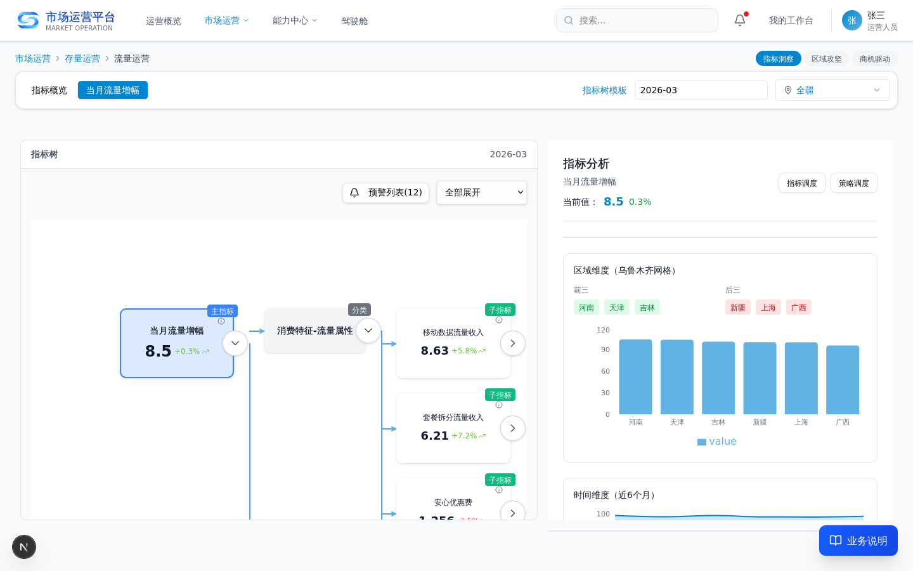

**操作要点**：
1. 进入流量运营页面，在「指标洞察」主 Tab 下切换至「当月流量增幅」二级 Tab；
2. 在左侧指标树选中「当月流量增幅」指标，右侧分析面板展示该指标的分析与诊断信息；
3. 点击分析面板右上角「**策略调度**」按钮，打开策略调度弹窗（进入环节②）。

**数据来源**：大数据平台指标数据（当月流量增幅指标）。
**下游消费**：策略调度弹窗，用于后续策略制定与派发。

---

### 环节② 选择策略

**页面**：策略调度弹窗 · 策略制定面板

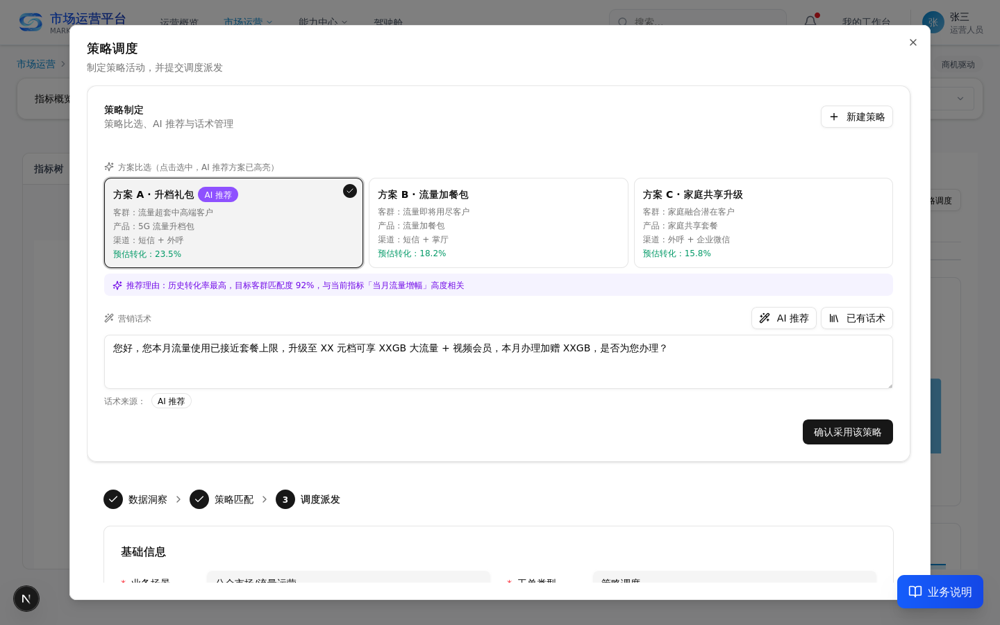

**操作要点**：
1. 查看「**方案比选**」区域 A/B/C 候选策略方案，AI 推荐方案高亮展示；
2. 管理「**营销话术**」，支持 AI 推荐话术 / 已有话术库 / 自主输入三种来源；
3. 点击「**确认采用该策略**」锁定所选方案与话术。

**数据来源**：策略库、话术库、AI 策略生成结果。
**下游消费**：确认的策略方案流转至调度派发表单（环节④）；如需新建策略，进入环节③。

---

### 环节③ 新增策略

**页面**：新建策略活动弹窗

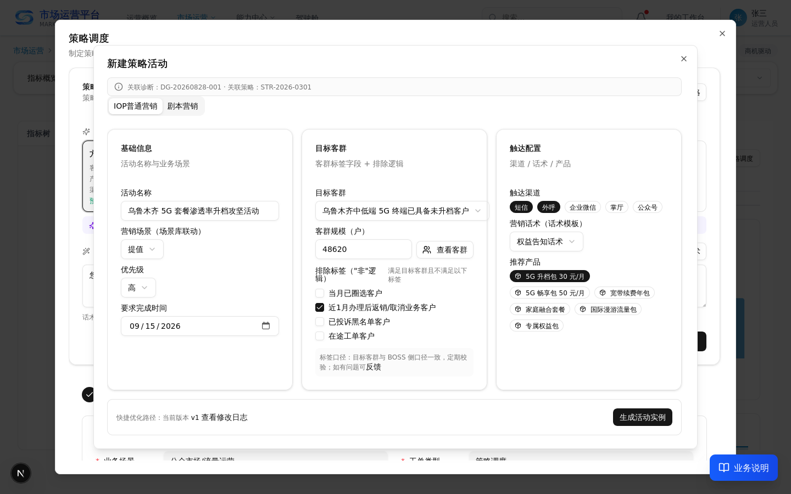

**操作要点**：
1. 在策略制定面板点击「**新建策略**」按钮，打开新建策略活动弹窗；
2. 配置目标客群、触达渠道、营销话术、推荐产品、优先级等策略要素；
3. 提交后系统生成带**全局活动 ID** 的活动实例，并回填至策略制定面板。

**数据来源**：客群标签、触达渠道、产品、话术模板（统一要素库）。
**下游消费**：生成的活动实例进入调度派发表单（环节④）。

---

### 环节④ 提交调度

**页面**：策略调度弹窗 · 调度派发表单

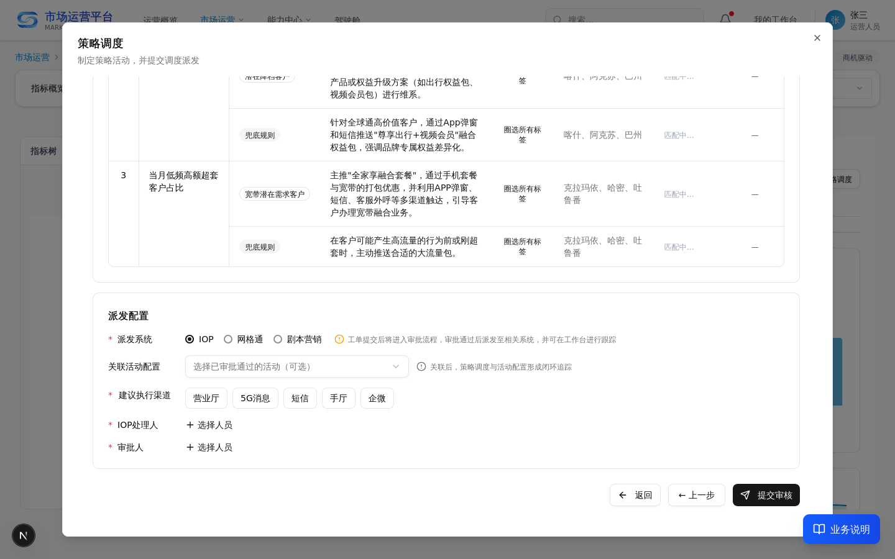

**操作要点**：
1. 填写基础信息（调度名称、业务场景、优先级等）；
2. 配置指标设置与任务列表；
3. 选择**派发系统**（IOP / 网格通 / 剧本营销）；
4. 指定处理人、审批人；
5. 点击「**提交审核**」生成策略调度工单。

**数据来源**：确认的策略方案、活动实例、派发系统配置。
**下游消费**：调度工单流转至调度中心（进入环节⑤）。

---

### 环节⑤ 工单调度

#### 5.1 调度总览

**入口路径**：顶部导航「能力中心 > 调度中心 > 调度总览」

**页面**：调度总览

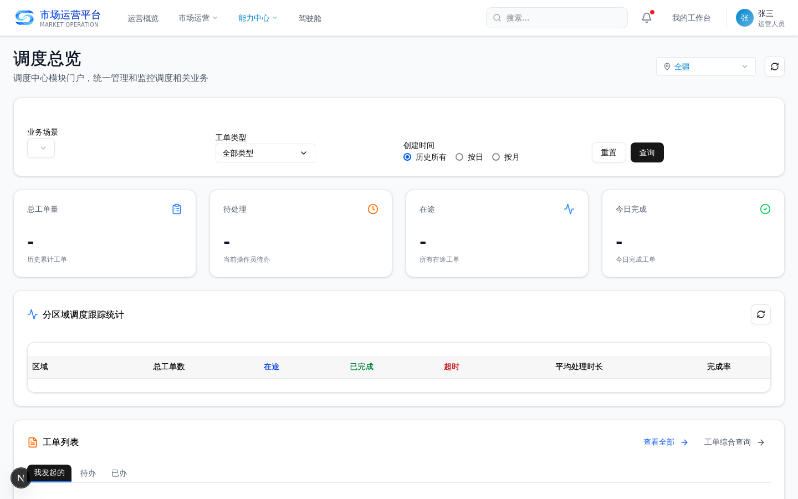

**操作要点**：
1. 在「我发起的 / 待办 / 已办」三个 Tab 查看调度工单；
2. 查看工单的调度类型（策略调度/客群调度/区域攻坚调度等）、状态、超时状态、区域、创建时间；
3. 点击目标工单进入工单详情（进入 5.2）。

**数据来源**：调度派发表单提交生成的调度工单。
**下游消费**：工单详情，用于查看策略与活动执行情况。

---

#### 5.2 工单详情

**入口路径**：调度总览点击工单进入；或通过工单详情链接直达

**页面**：工单详情

**基础信息与调度内容（策略列表）**：

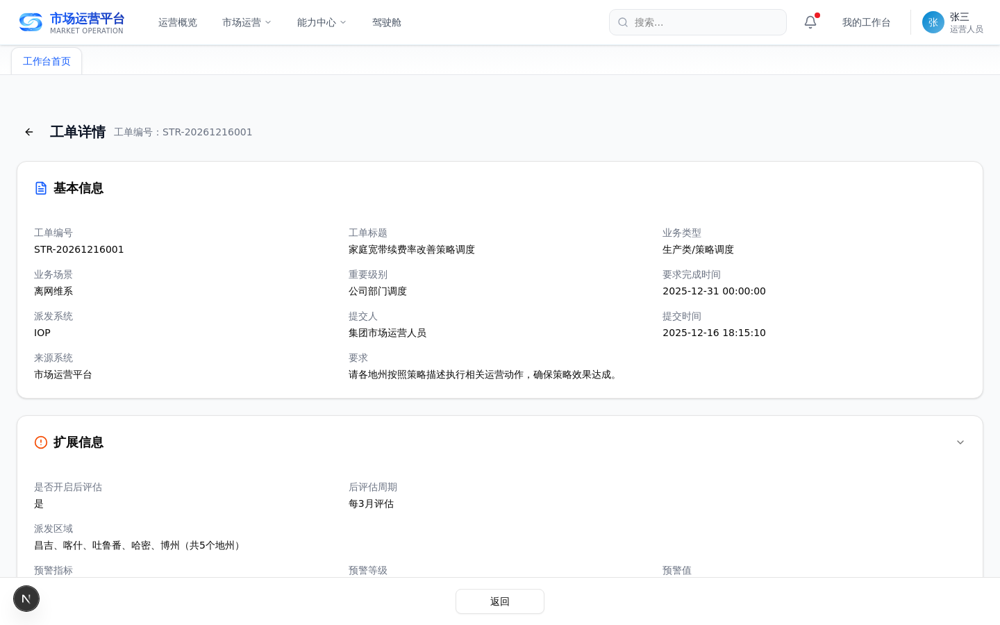

**关联活动信息（活动 ID/名称/状态/执行数据）**：

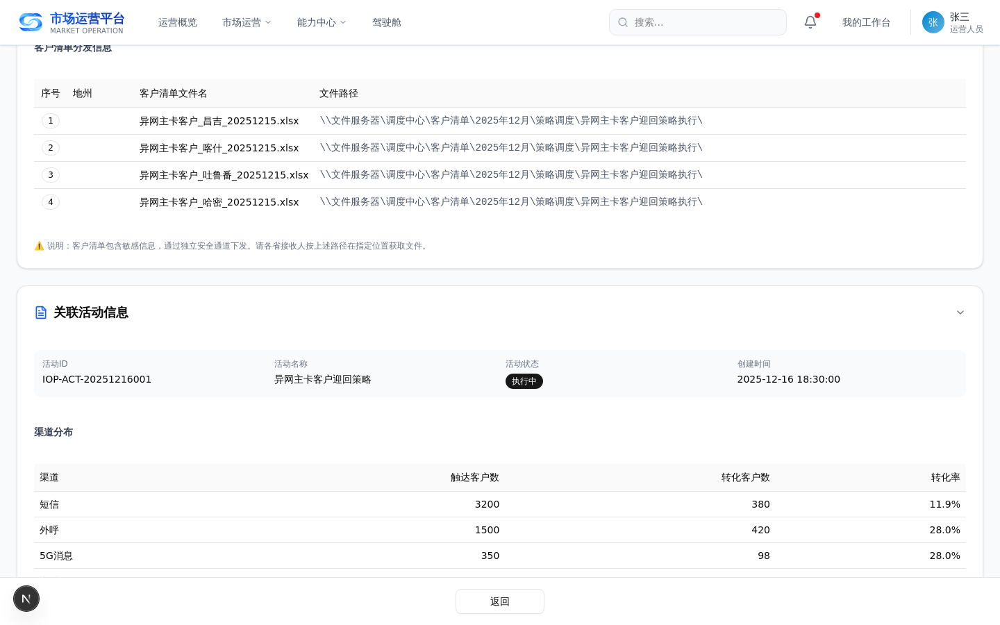

**执行情况（执行结果统计）**：

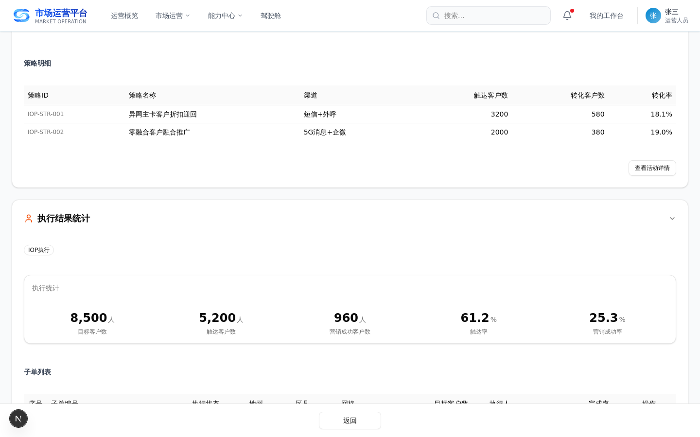

**操作要点**：
1. 查看工单基础信息（工单号、调度类型、业务类型、优先级、状态、区域、创建时间等）；
2. 查看「**调度内容**」：策略列表（关联指标、目标客群、策略描述、派发区域）、关联指标列表、客户清单分发信息；
3. 查看「**关联活动信息**」：活动 ID、活动名称、活动状态、创建时间、目标/触达/营销成功客户数、渠道分布、策略明细，并可点击「查看详情」跳转活动详情；
4. 查看「**执行结果统计**」：执行统计与子单列表，跟踪策略执行情况。

**数据来源**：策略方案、活动实例、派发系统（IOP/网格通）回传的执行数据。
**下游消费**：执行结果推送至评估中心（进入环节⑥）。

---

### 环节⑥ 评估中心

**入口路径**：顶部导航「能力中心 > 评估中心 > 策略分析」

**页面**：评估中心策略分析


**操作要点**：
1. 查看策略执行指标（派发/触达/成功/AI 采纳率等）；
2. 按区域钻取查看策略执行效果。

**数据来源**：调度中心执行结果。
**下游消费**：效果数据回流至策略沉淀「效果库」（进入环节⑦）。

---

### 环节⑦ 策略沉淀

#### 7.1 效果库

**入口路径**：顶部导航「能力中心 > 策略中心 > 策略沉淀 > 效果库」

**页面**：效果库

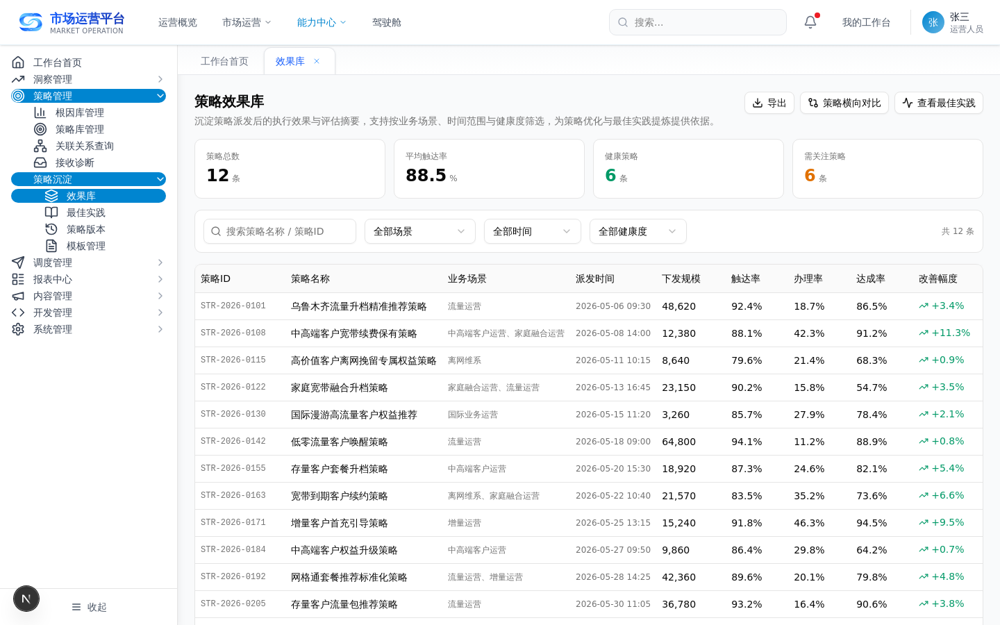

**操作要点**：
1. 查看策略健康度（五指标摘要）与效果记录；
2. 查看干预/未干预客群对比与价值分析；
3. 勾选多条策略执行策略横向对比；
4. 点击行内「**AI 复盘**」生成复盘报告（成效结论/归因/模板候选/改进建议）。

**数据来源**：评估中心效果回流数据。
**下游消费**：复盘结论沉淀至知识库，模板候选进入「模板管理」。

---

#### 7.2 模板管理

**入口路径**：顶部导航「能力中心 > 策略中心 > 策略沉淀 > 模板管理」

**页面**：模板管理

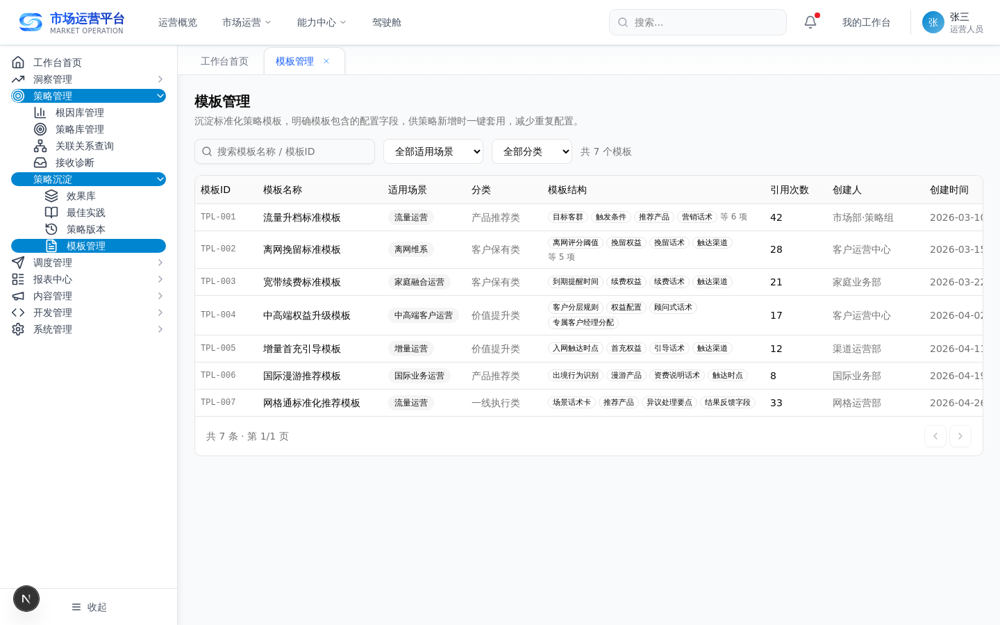

**操作要点**：
1. 查看策略模板与话术模板；
2. 查看被引用次数、最近引用时间；
3. 点击「**应用此模板**」跳转策略匹配页，开启新一轮定策。

**数据来源**：AI 复盘模板候选、用户保存的自定义模板。
**下游消费**：模板带入策略制定，反哺下一轮调度。

---

#### 7.3 策略库

**入口路径**：顶部导航「能力中心 > 策略中心 > 策略库」

**页面**：策略库

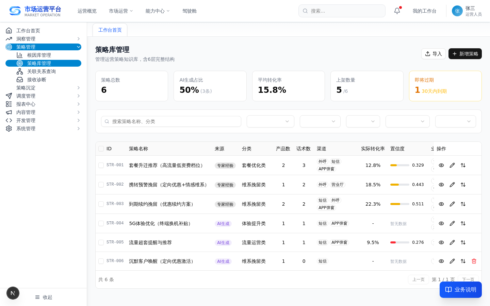

**操作要点**：
1. 查看沉淀的策略资产列表（策略名称、关联产品、话术、渠道、转化率等）；
2. 查看策略详情（7 层结构：基础信息 → 关联配置 → 产品/方案 → 渠道适配 → 营销话术 → 运行数据 → 使用记录）；
3. 复用策略发起下一轮调度。

**数据来源**：效果库复盘沉淀、策略制定过程中保存的策略。
**下游消费**：策略复用反哺下一轮策略调度。

---

## 三、端到端演示路径（一条指标异常走完策略调度全流程）

| 步骤 | 页面 | 操作 |
|---|---|---|
| 1 | 流量运营·当月流量增幅 | 定位异常指标，点击「策略调度」 |
| 2 | 策略制定面板 | 方案比选 + 营销话术 → 确认采用 |
| 3 | 新建策略活动弹窗 | 配客群/渠道/话术/产品/优先级 → 生成活动实例 |
| 4 | 调度派发表单 | 填基础信息 → 选派发系统 → 指定处理人/审批人 → 提交审核 |
| 5 | 调度总览 | 查看调度工单 → 进入工单详情 |
| 6 | 工单详情 | 查看策略信息 + 关联活动信息 + 执行情况 |
| 7 | 评估中心策略分析 | 查看策略执行指标、区域钻取 |
| 8 | 效果库 | 查看干预/未干预对比 → 触发 AI 复盘 |
| 9 | 模板管理 / 策略库 | 应用模板或复用策略 → 带入下一轮调度 |

---

> 附：所有页面截图由 Playwright 对运行中页面真实截取，存放于 `docs/操作手册/assets/`。
