# 策略中心全流程操作手册

> 版本：V1.0 ｜ 适用范围：市场数智运营平台·策略中心
> 核心主线：以「全局活动 ID」贯穿 **洞察 → 策略制定 → 调度 → 评估（策略分析）→ 沉淀** 全流程，实现"一条诊断结论 → 一个活动实例 → 效果回流 → 沉淀复用"的完整闭环。

---

## 一、流程总览

策略中心是连接「洞察、调度、评估」三大中心的枢纽，承担**诊断受理 → 策略定策 → 活动配置 → 审批下发**的核心职责，并将执行结果回流沉淀为可复用的策略资产。

```
洞察中心          策略中心（枢纽）               调度中心          评估中心
────────          ─────────────────               ────────          ────────
指标洞察 ──诊断结论──▶ ①接收诊断(受理)
根因诊断            ②策略匹配(三步定策)            派发配置
圈选客群            ③活动配置(三类Tab)  ──活动实例──▶ 工单下发     ──执行结果──▶ 策略分析
                    ④策略审批(通过)               执行监控                        效果库
                                                            │
                              ▲ 沉淀复用 ◀──────────────────┘
                              │（模板/最佳实践反哺下一轮定策）
```

| 环节 | 中心 | 关键页面 | 说明 |
|---|---|---|---|
| ① 洞察 | 洞察中心 | 洞察总览 | 指标异常检测、根因诊断、圈选客群，产出诊断结论 |
| ② 策略制定 | 策略中心 | 接收诊断 / 策略匹配 / 活动配置 / 策略审批 | 受理诊断、三步定策、配置活动实例、审批 |
| ③ 调度 | 调度中心 | 调度总览 / 活动全链路追踪 | 派发配置、工单下发、执行监控、全程追踪 |
| ④ 评估（策略分析） | 评估中心 | 评估中心策略分析 / 效果库 | 效果评估、干预/未干预对比、AI 复盘 |
| ⑤ 沉淀 | 策略沉淀/知识库 | 模板管理 / 最佳实践 / 策略总览 | 复盘沉淀、模板复用、闭环看板 |

---

## 二、分环节操作说明

### 环节① 洞察：指标洞察与诊断

**入口路径**：顶部导航「能力中心 > 洞察中心 > 洞察总览」

**页面**：洞察总览

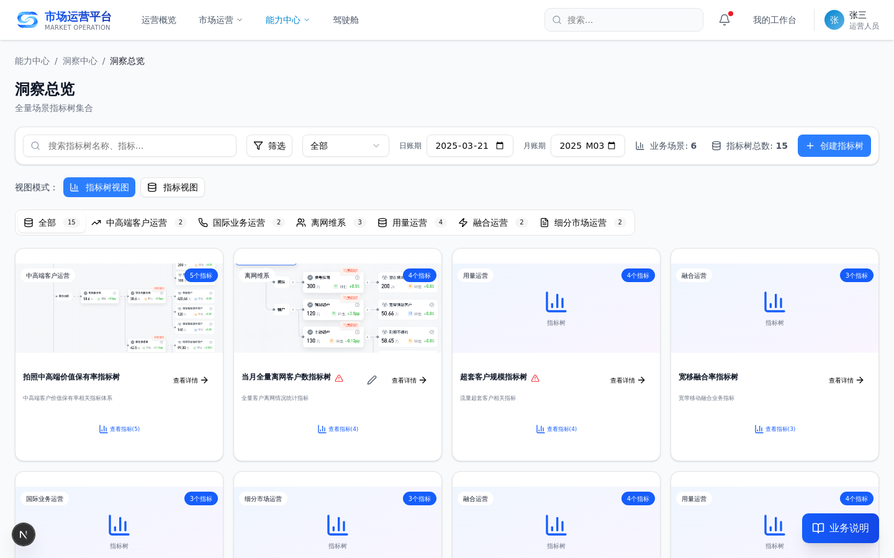

**操作要点**：
1. 在洞察总览查看指标异常检测与根因诊断分析结果；
2. 通过指标树定位异常指标，圈选风险客群；
3. 系统生成「诊断结论」并推送至策略中心（进入环节②）。

**数据来源**：大数据平台指标数据、客群数据。
**下游消费**：诊断结论流转至策略中心「接收诊断」。

---

### 环节② 策略制定：从诊断到活动实例

#### 2.1 接收诊断（受理）

**入口路径**：顶部导航「能力中心 > 策略中心 > 接收诊断」

**页面**：接收诊断

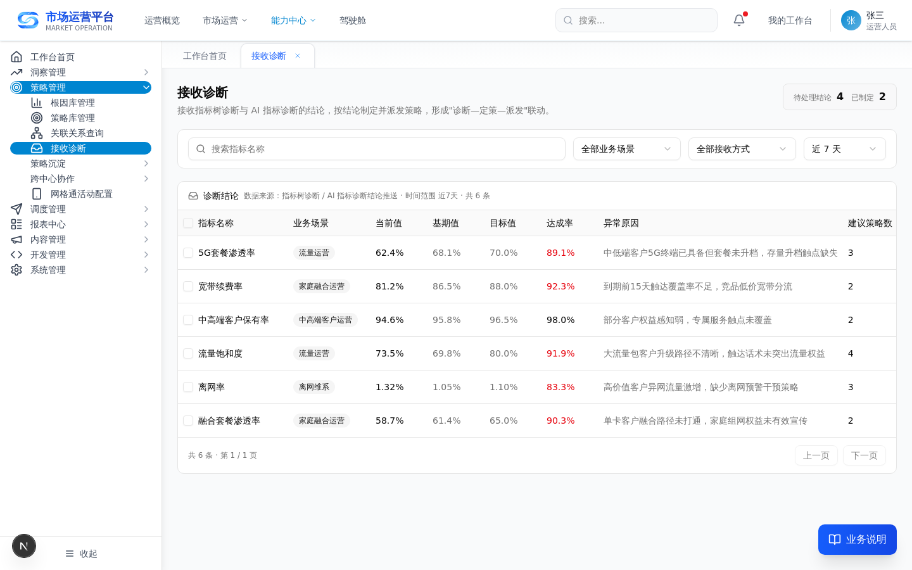

**操作要点**：
1. 在「待处理」列表查看洞察中心推送的诊断结论；
2. 对每条诊断执行受理动作：
   - **承接**：受理并进入定策流程；
   - **拒收**：填写拒收理由；
   - **转派**：选择接收方转派；
   - **忽略**：标记忽略并说明原因。
3. 受理后系统记录受理人、受理时间、处置结论。

**数据来源**：洞察中心诊断结论。
**下游消费**：承接的诊断进入「策略匹配」三步定策。

---

#### 2.2 策略匹配（三步定策）

**入口路径**：接收诊断页点击「承接」→ 进入策略匹配；或顶部导航「能力中心 > 策略中心 > 策略匹配」

**页面**：策略匹配（三步定策）

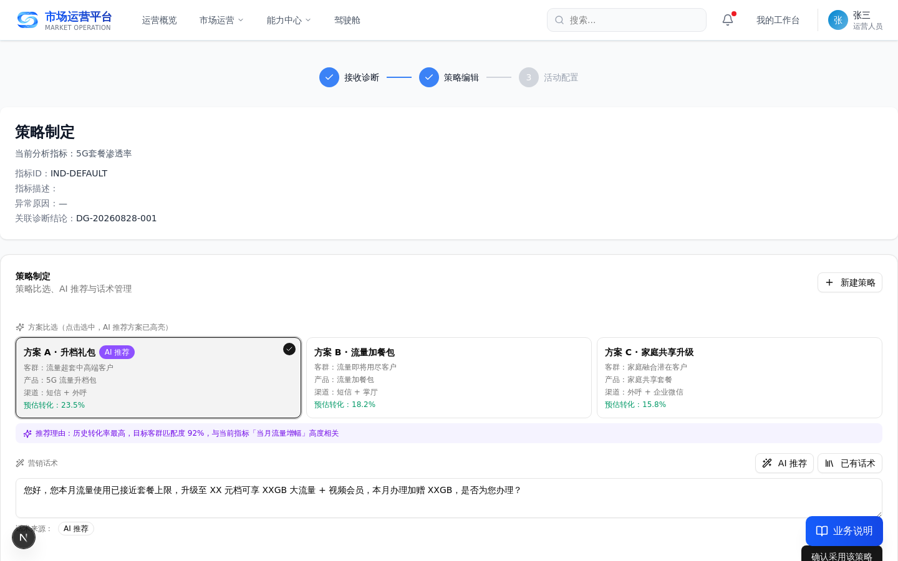

**页面结构**（步骤条：接收诊断 → 策略编辑 → 活动配置）：
1. **指标信息卡片**：查看带入的诊断结论与当前分析指标信息（指标名称、指标ID、指标描述、异常原因、关联诊断结论）；
2. **策略制定**：方案比选（A/B/C 候选方案，AI 推荐方案高亮）+ 营销话术管理（AI 推荐 / 已有话术 / 自主输入）+ 新建策略；
3. **策略编辑**：新增根因指标、编辑原因分析、配置客群与策略要素；
4. **去调度**：点击「去调度」打开策略调度弹窗，复用策略调度工单流程完成派发。

**数据来源**：接收诊断带入的诊断结论、策略库、话术库。
**下游消费**：点击「去调度」进入策略调度流程，生成调度工单。

---

#### 2.3 活动配置统一页

**入口路径**：顶部导航「能力中心 > 策略中心 > 活动配置」；或策略匹配页点击「新建策略」打开新建活动弹窗

**页面**：活动配置统一页

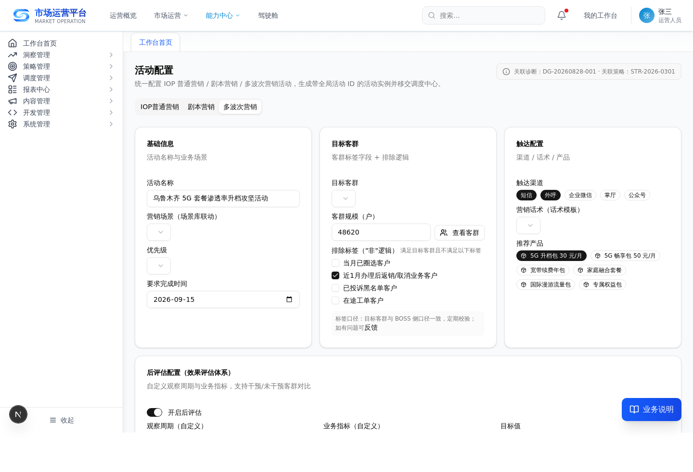

**操作要点**：
1. 选择活动类型 Tab（**IOP 普通营销 / 剧本营销 / 多波次营销**）；
2. 配置目标客群（支持标签口径说明、排除逻辑、反馈入口）；
3. 配置触达渠道、营销话术（分段预览）、推荐产品（依赖产品提示）、优先级；
4. 配置**后评估**：观察周期、业务指标、是否启用干预/未干预对比；
5. 查看触点优化项（场景库联动、测试预览、短信测试、触点反馈字段、效果口径说明）；
6. 点击「生成活动实例」，系统生成带**全局活动 ID** 的活动实例并进入审批。

**数据来源**：客群标签、渠道、产品、话术模板（统一要素库）。
**下游消费**：活动实例进入「策略审批」。

---

#### 2.4 策略审批

**入口路径**：顶部导航「能力中心 > 策略中心 > 策略审批」

**页面**：策略审批

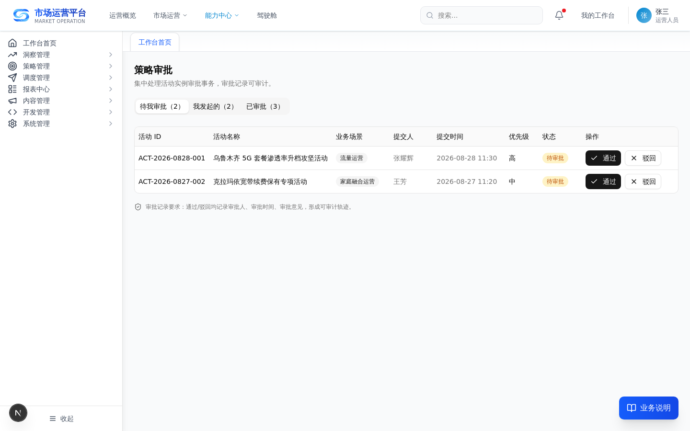

**操作要点**：
1. 在「待我审批」查看待审批活动实例；
2. 执行**通过**或**驳回**（填写驳回理由）；
3. 「我发起」查看本人发起的审批，「已审批」查看历史审批记录。

**数据来源**：活动配置页生成的活动实例。
**下游消费**：审批通过的活动实例推送至调度中心。

---

### 环节③ 调度：派发与全程追踪

#### 3.1 调度总览

**入口路径**：顶部导航「能力中心 > 调度中心 > 调度总览」

**页面**：调度总览

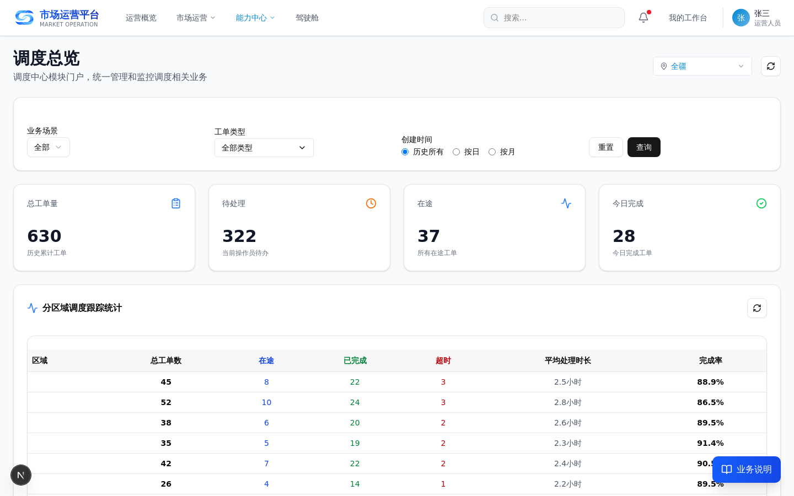

**操作要点**：
1. 查看调度任务总览（派发配置、工单下发、执行监控）；
2. 跟踪活动实例的派发与执行状态。

**数据来源**：策略中心审批通过的活动实例。
**下游消费**：执行结果推送至评估中心。

---

#### 3.2 活动全链路追踪

**入口路径**：顶部导航「能力中心 > 策略中心 > 活动全链路追踪」

**页面**：活动全链路追踪

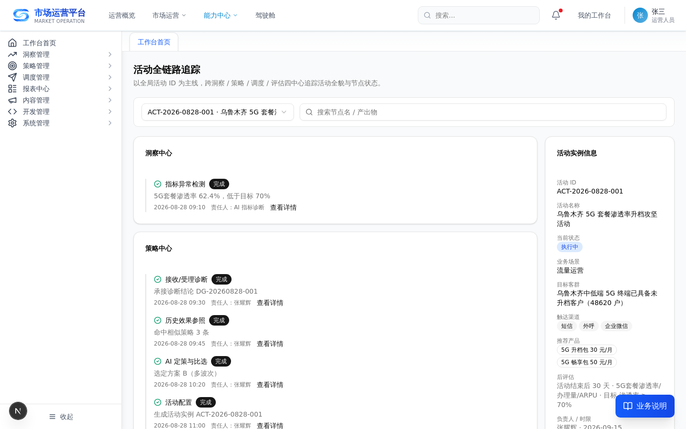

**操作要点**：
1. 选择活动实例（按全局活动 ID）；
2. 查看横向时间轴：**洞察中心 → 策略中心 → 调度中心 → 评估中心 → 策略中心沉淀**；
3. 查看各节点状态（完成/进行中/阻塞）、责任人、时间、产出；
4. 异常卡点高亮提示。

**数据来源**：全局活动实例时间轴数据。
**下游消费**：定位活动卡点，辅助运营决策。

---

### 环节④ 评估（策略分析）：效果评估与复盘

#### 4.1 评估中心·策略分析

**入口路径**：顶部导航「能力中心 > 评估中心 > 策略分析」

**页面**：评估中心策略分析

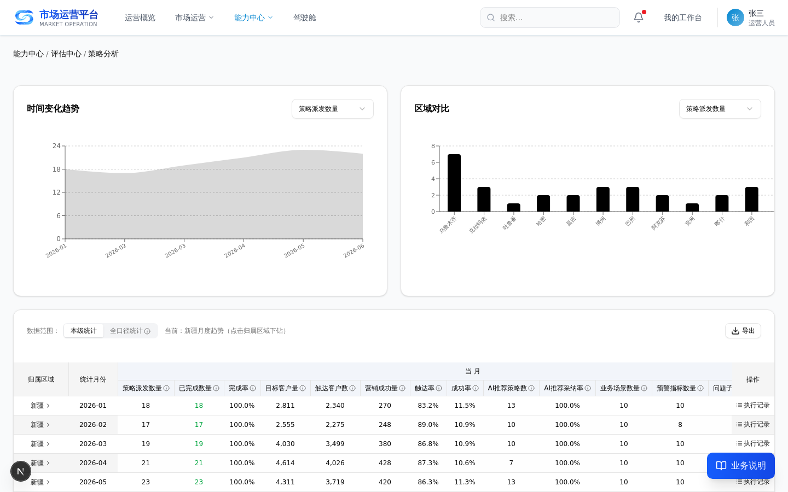

**操作要点**：
1. 查看策略执行指标（14 列策略执行指标）；
2. 按区域钻取查看策略执行效果。

**数据来源**：调度中心执行结果。
**下游消费**：效果数据回流至策略中心「效果库」。

---

#### 4.2 效果库

**入口路径**：顶部导航「能力中心 > 策略中心 > 策略沉淀 > 效果库」

**页面**：效果库


**操作要点**：
1. 查看策略健康度（五指标摘要）与效果记录；
2. 查看**干预/未干预客群对比**与价值分析；
3. 勾选多条策略执行**策略横向对比**；
4. 点击行内「**AI 复盘**」生成复盘报告（成效结论/归因/模板候选/改进建议）。

**数据来源**：评估中心效果回流数据。
**下游消费**：复盘结论沉淀至知识库，模板候选进入「模板管理」。

---

### 环节⑤ 沉淀：资产沉淀与复用

#### 5.1 模板管理

**入口路径**：顶部导航「能力中心 > 策略中心 > 策略沉淀 > 模板管理」

**页面**：模板管理

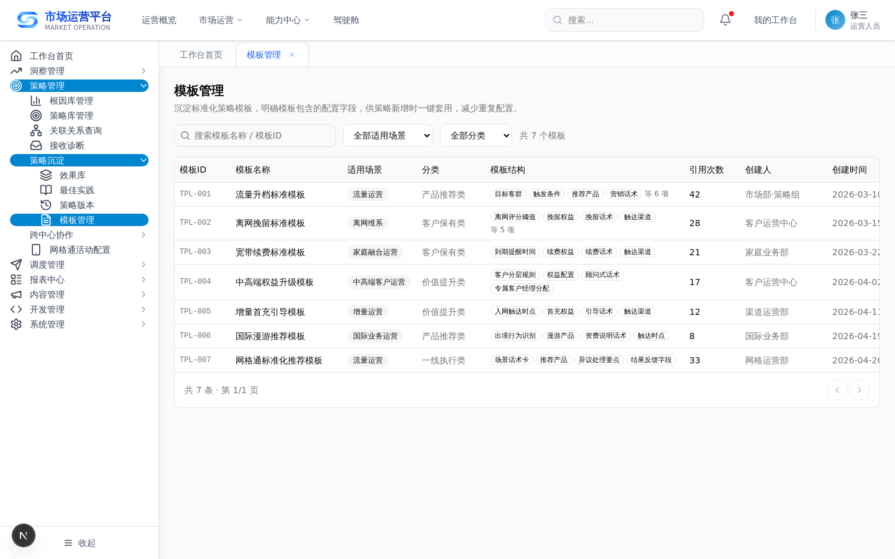

**操作要点**：
1. 查看策略模板与话术模板；
2. 查看被引用次数、最近引用时间；
3. 点击「**应用此模板**」跳转策略匹配页，开启新一轮定策。

**数据来源**：AI 复盘模板候选、用户保存的自定义模板。
**下游消费**：模板带入「策略匹配」三步定策。

---

#### 5.2 最佳实践

**入口路径**：顶部导航「能力中心 > 策略中心 > 策略沉淀 > 最佳实践」

**页面**：最佳实践

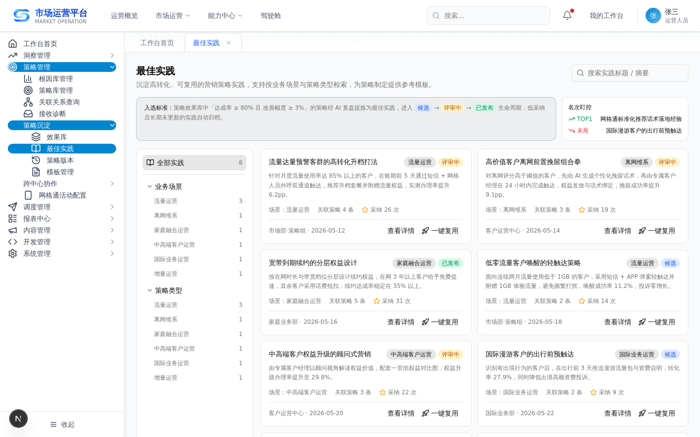

**操作要点**：
1. 按入选标准查看最佳实践案例；
2. 查看案例生命周期状态（候选→评审→发布→归档）；
3. 查看 TOP/末尾名次盯控；
4. 点击「**一键复用**」带入定策。

**数据来源**：效果库优秀/失败案例。
**下游消费**：案例复用反哺下一轮定策。

---

#### 5.3 策略总览（闭环看板）

**入口路径**：顶部导航「能力中心 > 策略中心 > 策略总览」

**页面**：策略总览

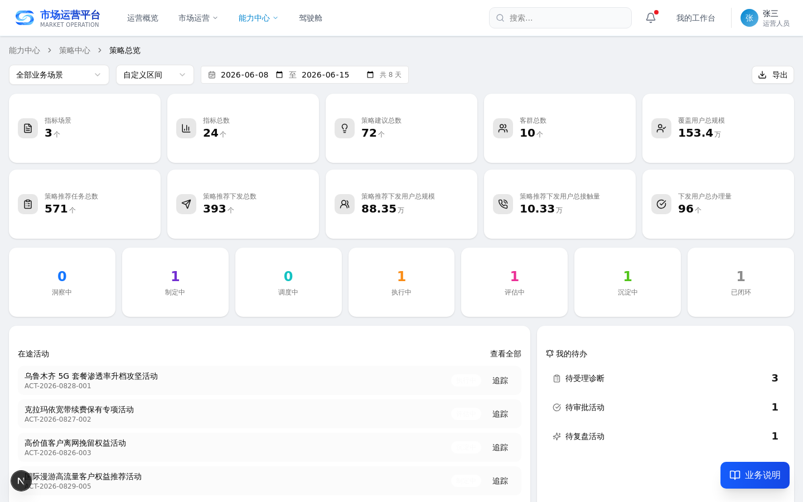

**操作要点**：
1. 查看策略统计卡（策略数量、覆盖用户、下发/转化趋势）；
2. 查看**活动生命周期看板**（7 状态泳道）；
3. 查看**我的待办**（待受理诊断/待审批/待复盘）；
4. 查看**策略健康度分布**与**沉淀资产概览**。

**数据来源**：全流程活动实例与策略资产数据。
**下游消费**：作为策略中心运营中枢入口。

---

## 三、端到端演示路径（一条诊断结论走完全流程）

| 步骤 | 页面 | 操作 |
|---|---|---|
| 1 | 洞察总览 | 查看指标异常/根因诊断，产出诊断结论 |
| 2 | 接收诊断 | 对待处理诊断执行「承接」 |
| 3 | 策略匹配 | 三步定策：策略制定（方案比选+话术）→ 策略编辑 → 去调度 |
| 4 | 活动配置 | 选活动类型 → 配客群/渠道/话术/产品/观察周期/业务指标 → 生成活动实例 |
| 5 | 策略审批 | 审批通过活动实例 |
| 6 | 调度总览 | 查看派发与执行 |
| 7 | 活动全链路追踪 | 查看时间轴推进与节点状态 |
| 8 | 评估中心策略分析 | 查看策略执行指标 |
| 9 | 效果库 | 查看干预/未干预对比 → 触发 AI 复盘 |
| 10 | 模板管理 / 最佳实践 | 应用模板或一键复用 → 带入下一轮定策 |
| 11 | 策略总览 | 查看闭环看板（活动已闭环、资产已沉淀） |

---

> 附：所有页面截图由 Playwright 对运行中页面真实截取，存放于 `docs/操作手册/assets/`。
