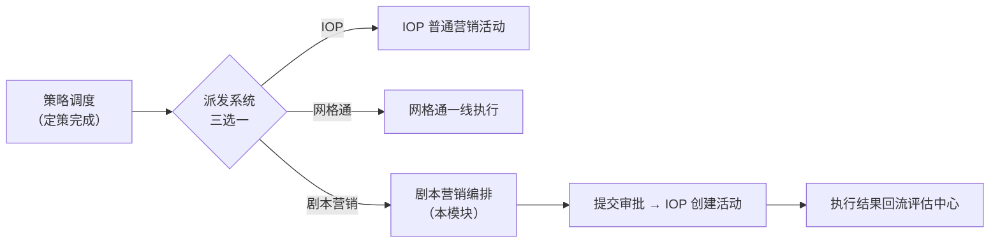
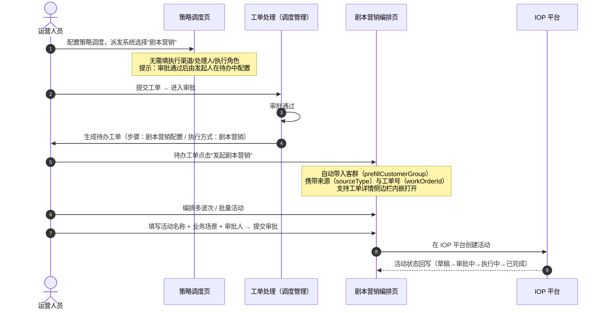

# 剧本营销原型与业务逻辑说明

> 所在位置：能力中心 → 策略中心 → 剧本营销
> 说明范围：原型页面构成、核心业务逻辑、与策略调度/工单流转的衔接、数据来源与优化建议

---

## 一、一句话定位

**剧本营销 = 一套"分步骤、有节奏、跨渠道"的客户营销活动编排工具。**

它不是一次性的短信群发，而是像"电视剧分幕"一样，把营销过程拆成"第一幕、第二幕、第三幕"：每一幕做什么（选客群、选渠道、选产品、选话术），上一幕没打动客户，隔几天换渠道再触达一次——**直到客户办理或活动结束**。

在策略中心里的位置：



> 关键点：策略调度中选择"剧本营销"时，系统**不直接派单**，而是给发起人生成一条待办工单，由发起人进入剧本营销页面完成编排后再提交。

---

## 二、页面构成（两个页面）

### 2.1 剧本营销列表页（能力中心 → 策略中心 → 剧本营销）

| 区域 | 内容 |
|---|---|
| 页面标题 | "剧本营销"，副标题说明：管理 IOP 剧本营销活动，支持多波次流程和批量策划两种类型 |
| 主操作 | 【新建剧本营销】按钮 → 进入全屏编排页 |
| 筛选区 | 搜索框（活动名称/编号）+ 状态按钮组（全部 / 草稿 / 审批中 / 执行中 / 已完成） |
| 列表列 | 活动编号、活动名称、剧本类型、业务场景、幕数/活动数、状态、创建时间、更新时间、操作 |
| 行操作 | 查看（所有状态可见）；**编辑（仅"草稿"状态可见）** |
| 状态样式 | 草稿=灰、审批中=描边、执行中=主色、已完成=灰 |
| 空态 | "暂无剧本营销活动" |

列表示例数据（演示用）：全球通携转预警多波次维系（多波次流程 / 3 幕 / 执行中）、4G升5G批量营销活动（批量策划 / 5 个活动 / 审批中）、中高端客户流量提升剧本（多波次 / 2 幕 / 草稿）等。

### 2.2 剧本营销编排页（全屏画布）

页面分四个横向区域：

| 区域 | 内容 |
|---|---|
| 顶部栏 | ← 返回列表；标题"剧本营销"；客群徽标（若从工单带入客群会显示"客群：XXX"）；**剧本类型切换**（多波次流程 / 批量策划多个活动）；活动名称输入框 |
| 中部左区 | **流程画布**（点阵背景）：竖向排列的节点卡片，卡片间用箭头连接；节点卡片显示类型色条 + 摘要文本（未选客群/未选渠道/未配置话术等） |
| 中部右区 | **节点配置面板**（380px，点击画布节点后出现）：按节点类型渲染不同表单，底部"确定"按钮 |
| 底部 | **活动元素组件库**：选客群、选渠道、选产品、选话术四个可添加元素 + 多波次模式下的"添加新幕"按钮 |
| 底部操作栏 | 返回；**业务场景**选择；**审批人**输入；【提交审批】按钮（三项必填才可点击） |

---

## 三、核心业务逻辑

### 3.1 两种剧本类型（本质区别）

| 类型 | 结构 | 适用场景 |
|---|---|---|
| **多波次流程** | 幕（第一幕 → 幕间规则 → 第二幕 → 幕间规则 → 第三幕…）**串行推进** | 需要"多轮触达、按客户反应决定下一步"的营销，如携转维系、流量提升 |
| **批量策划多个活动** | 多个活动卡片**并行排列**，每个活动各自一条"客群→渠道→产品→话术"流程 | 一次策划多个平行业务，如"4G升5G"同时对不同客群投放不同活动 |

### 3.2 多波次流程：幕与幕间规则（核心机制）

**一幕 = 一次完整触达动作**，包含 4 类元素（固定顺序）：

```
选客群 → 选渠道 → 选产品 → 选话术
```

- **第一幕的客群节点是锁定的**（必选、不可删除），代表本次活动面向的目标客户群；
- 第二幕起可删除整幕，也可在幕内增删节点；
- **幕间规则**：连接两幕的"分支判断条件"，配置三项：
  1. 接触状态：已接触 / 未接触
  2. 办理状态：已办理 / 未办理
  3. 等待时间窗口：数值 + 单位（小时 / 天），默认 3 天

**业务含义**：上一幕执行后，系统按"接触状态 + 办理状态"筛选客户，等待指定时间后把符合条件的客户推进到下一幕。

> 举例：第一幕短信触达 → 若客户"未接触且未办理" → 等 3 天 → 第二幕改用外呼触达 → 仍未办理 → 等 5 天 → 第三幕换 5G 消息触达。

### 3.3 四类活动元素（节点）配置字段

| 节点 | 配置字段 | 数据来源 |
|---|---|---|
| **选客群** | 客群名称（输入/选择） | 经分标签圈选、标签库筛选、客群编码导入 |
| **选渠道** | 渠道类型（16 个渠道：CRM统一运营位、前台营业厅、短信营业平台、5G消息、时机库、10086客服、互联网公司、渠道联盟APP、在线外呼、装维APP、智能外呼、彩信、微信营业厅、乐播TV、咪咕通APP 等）；运营位（统一运营位CRM / 前台运营位CRM / 短信平台运营位，必填）；活动类型（主推/辅助/跟进，必填）；触发事件（CRM业务办理/短信接收/手厅登录，必填）；活动用语（必填） | IOP 渠道与运营位配置 |
| **选产品** | 推荐产品/套餐（100元流量月包、5G升级包、家庭融合套餐、全球通尊享套餐、千兆宽带套餐等） | 产商品中心，可按业务场景筛选 |
| **选话术** | 话术模板（流量达量预警、5G升级推荐、维系挽留、家庭融合推荐）+ 自定义话术（可自由编辑文本） | 话术库 / 策略库 |
| **幕间规则** | 接触状态、办理状态、等待时间窗口（数值 + 小时/天） | 活动执行过程自动产生（接触/办理状态来自执行侧反馈） |

### 3.4 交互规则

1. 点击画布节点 → 右侧打开该节点的配置面板，修改实时生效（节点卡片摘要同步更新）；
2. 客群节点不可删除，其他节点悬停出现删除按钮；
3. 组件库点击"选渠道"等 → 自动追加节点到**最后一幕 / 最后一个活动**末尾；
4. 多波次模式点"添加新幕" → 自动新增一幕（含默认 4 个节点）+ 一条幕间规则；
5. 删除某一幕时，其对应的幕间规则一并删除（第一幕不可删）。

---

## 四、与工单流转的衔接（端到端）



**衔接要点**：

| 环节 | 说明 |
|---|---|
| 派发系统选择 | 策略调度"派发配置"区三选一：IOP / 网格通 / 剧本营销；选"剧本营销"后表单简化（隐藏执行渠道、处理人、执行角色） |
| 提示语 | "工单提交后将进入审批流程，审批通过后需在待办工单中发起剧本营销，客群将自动带入 IOP 剧本营销页面" |
| 待办生成 | 审批通过后系统为**发起人**生成待办工单，工单类型为策略调度 / 客群调度，当前步骤 = "剧本营销配置" |
| 页面跳转 | 待办中"发起剧本营销" → 编排页，URL 携带：客群名称（自动预填到第一幕的客群节点）、来源类型、工单号；支持 `mode=sidebar` 在工单详情内嵌打开 |
| 提交出口 | 编排完成后提交审批 → 在 IOP 平台创建实际营销活动 |
| 状态回流 | 活动状态在列表页可见（草稿 / 审批中 / 执行中 / 已完成）；执行结果最终回流评估中心 |

---

## 五、数据来源与下游消费

| 数据 | 来源 | 消费者 |
|---|---|---|
| 客群 | 洞察中心（经分标签圈选、标签库、客群编码）或工单带入 | 第一幕客群节点、IOP 活动投放对象 |
| 产品 | 产商品中心 | 节点配置、IOP 活动推荐产品 |
| 话术 | 话术库 / 策略库 | 节点配置、IOP 活动话术下发 |
| 渠道与运营位 | IOP 渠道配置 | 节点配置、活动触达执行 |
| 活动名称 / 业务场景 / 审批人 | 用户在编排页填写 | 工单流转、IOP 活动创建 |
| 接触 / 办理状态 | 执行侧（IOP / 网格通等）执行反馈 | 幕间规则判断、下一幕推进 |
| 活动状态 | IOP 平台回写 | 列表页展示、活动效果统计 |

> 完整闭环：**洞察（圈客群）→ 策略（定方案）→ 剧本编排（配活动）→ IOP 执行（做触达）→ 状态与结果回流（看效果）→ 评估中心（评效果）**。

---

## 六、页面元素速查表

### 6.1 列表页

| 元素 | 类型 | 说明 |
|---|---|---|
| 搜索框 | 输入 | 按活动名称 / 活动编号模糊搜索 |
| 状态筛选 | 按钮组 | 全部 / 草稿 / 审批中 / 执行中 / 已完成 |
| 新建按钮 | 主按钮 | 进入编排页（空白新建） |
| 列表 | 表格 | 8 列，按状态渲染不同操作按钮 |
| 行操作 | 按钮 | 查看（全部）；编辑（仅草稿） |

### 6.2 编排页

| 元素 | 说明 |
|---|---|
| 剧本类型切换 | 单选：多波次流程 / 批量策划多个活动 |
| 活动名称 | 顶部输入框（必填） |
| 画布 | 点阵背景，节点卡片纵向排列 + 箭头连接；多波次按"幕"分组显示徽标（第一幕 / 第二幕…） |
| 节点卡片 | 类型色条 + 名称 + 摘要（客群名 / 渠道 / 产品 / 话术前 20 字 / 规则摘要）+ 删除按钮 |
| 配置面板 | 按节点类型渲染表单，底部"确定" |
| 组件库 | 选客群 / 选渠道 / 选产品 / 选话术（+ 添加新幕） |
| 业务场景 | 下拉选择（必填） |
| 审批人 | 输入框（必填） |
| 提交审批 | 主按钮，三项必填校验通过后可用 |
| 客群徽标 | 若从工单带入客群，顶部显示"客群：XXX" |

---

## 七、现状边界与优化建议

### 7.1 原型现状（如实说明）

| 项 | 现状 |
|---|---|
| 数据 | 列表页为演示数据（4 条示例活动），非真实接口 |
| 提交动作 | 提交审批为前端提示（"剧本营销活动已提交审批，将在 IOP 平台创建活动"），未对接 IOP 真实接口 |
| 列表操作 | "查看"、"编辑"按钮已按状态渲染，但暂未实现跳转逻辑 |
| 保存能力 | 编排页无"草稿保存"入口，离开页面配置不保留 |
| 幕间规则 | 仅支持单一条件组合（接触状态 + 办理状态 + 等待时间），不支持多条件分支 / 并行分支 |
| 剧本预览 | 无"客户视角预览"（看不到一个客户会经历哪几步） |

### 7.2 优化建议（按优先级）

| 优先级 | 建议 | 价值 |
|---|---|---|
| P0 | 列表页"查看 / 编辑"跳转编排页（编辑态回填配置） | 让现有页面形成闭环，验收可演示 |
| P0 | 编排页增加"保存草稿" + 离开二次确认 | 避免配置丢失，符合真实使用习惯 |
| P1 | 增加"剧本预览 / 模拟走查"：输入一个示例客户，展示其将经历的幕与触达动作 | 直观验证编排正确性，便于向业务方演示 |
| P1 | 幕间规则升级为"条件分支"（支持按渠道 / 产品 / 客群属性多条件判断） | 贴近真实营销场景，也便于与 IOP 能力对齐 |
| P2 | 与 IOP 接口对接（活动创建、状态回写） | 从原型走向可用 |
| P2 | 活动效果标签：列表页增加触达率 / 办理率列，与评估中心策略评估摘要联动 | 让"效果回流"在剧本营销侧可见 |

---

## 附：相关材料

- 已生成截图：`docs/需求设计方案/screenshots/04-剧本营销管理页.png`、`05-剧本营销策划页.png`、`03-工单详情-剧本营销.png`
- 相关方案：`docs/需求设计方案/IOP剧本营销融合设计方案.docx`、`docs/需求设计方案/策略中心优化方案V1.0.md`
