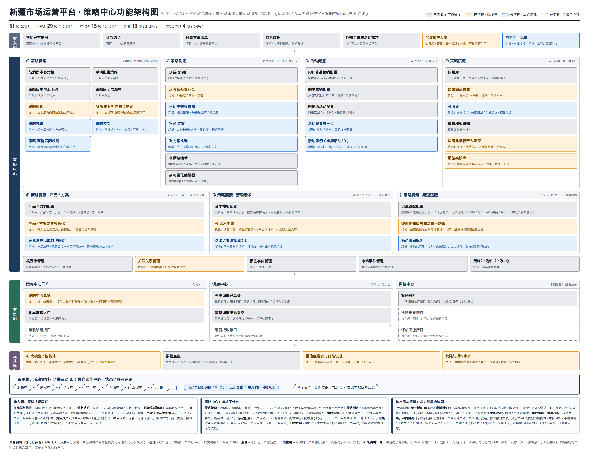
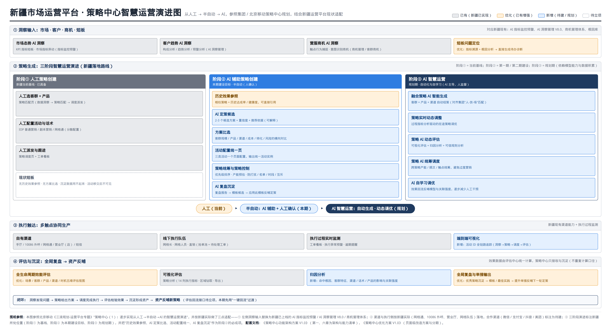
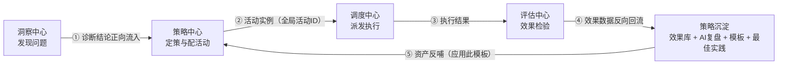
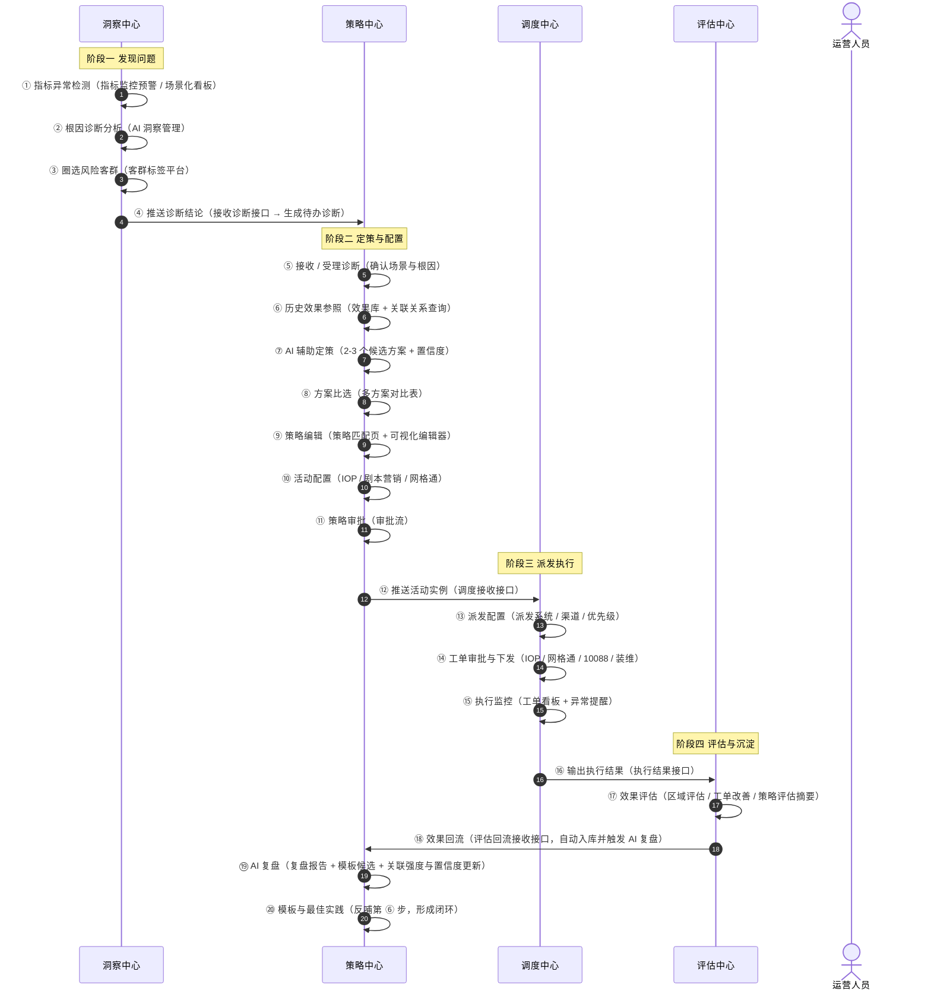
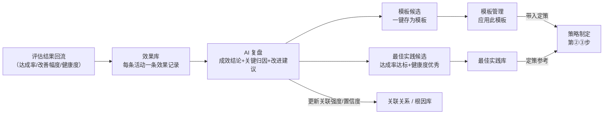
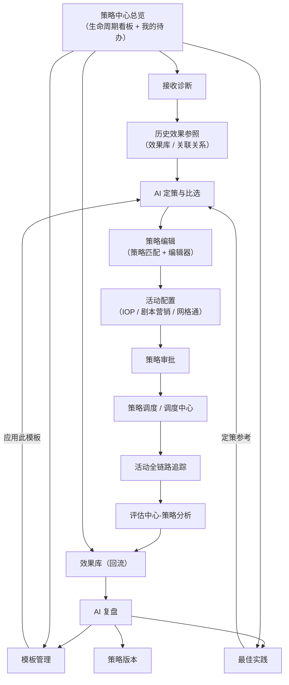
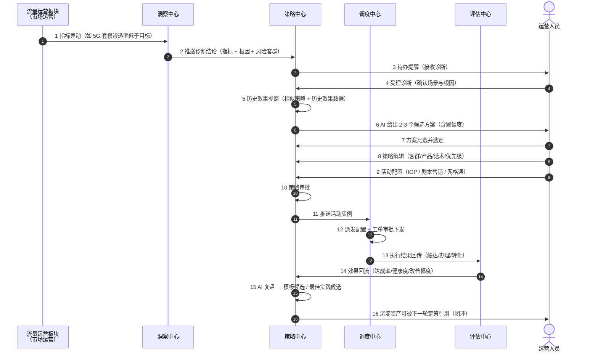

# 策略中心优化方案 V1.0

### —— 从"策略配置工具"升级为"营销活动运营中枢"（含页面原型优化与拓展方案）

> **文档用途**：面向客户与项目组，说明在现有运营平台已实现的策略相关能力基础上，需要怎么改、改哪些页面、补充哪些能力，以落实客户提出的"策略中心是营销活动全流程的集中管理、处理、沉淀"定位要求。
>
> **编制依据**：
> 1. 《策略管理与市场运营调度体系关系及数据流转分析（流量运营场景）》；
> 2. 《策略中心.md》（策略中心范围与边界 V0.3）；
> 3. 客户需求讨论中提出的核心意见与下一步工作要求；
> 4. 北京移动《三滚规划-运营平台专题 V2.2@1203 —策略中心》策略中心（1）～（6）；
> 5. 中国移动商机中心总体规划思路、一体化运营体系全景视图（洞察 / 策略 / 调度 / 评估四中心 + AI 底座）；
> 6. 现有原型实现现状（代码级核实）。

---

## 〇、功能架构图（三色标注：已有 / 优化 / 新增）

> 本方案的功能范围与优先级，已图形化为三色标注图与阶段实现计划图（灰 = 已实现、橙 = 已实现待增强、蓝 = 未实现新建、白底虚框 = 未实现待接口立项）。逐项标注、现状依据与优先期见《策略中心功能架构方案 V1.0》第六章（61 项能力清单），本方案第五章 P1～P12 是这些能力项的**页面级落地表达**。

### 0.1 图一：策略中心分层功能架构图（三色标注）

**读图要点**：L0 输入侧（洞察中心诊断结论、客群、商机、外部工单、沉淀资产）→ L1 策略中心四大能力域（① 策略管理 ② 策略制定 ③ 活动配置 ④ 策略沉淀）+ 策略知识底座 → L2 输出侧（策略中心门户、调度中心、评估中心）→ L3 支撑底座（AI 大模型 / 智能体、数据底座、置信度与口径、权限与审计）。
计数：**61 项能力 —— 已实现 29 项、已实现待增强 15 项、未实现新建 13 项、未实现待接口立项 4 项（跨中心接口）**。

### 0.2 图二：策略中心智慧运营演进图（人工 → 半自动 → AI，新疆版）

**读图要点**：新疆当前处于**阶段①（人工策略创建）**；本期建设目标是**阶段②（AI 辅助策略创建 + 人工确认）**，必成项为"历史效果参照、AI 定策与比选、活动配置统一页、AI 复盘沉淀"；**阶段③（AI 智能生成 / 实时动态调整 / 统筹调度 / 自学习调优）** 属规划期，前置依赖样本积累与四个跨中心接口立项。

### 0.3 与本文档的对应关系

| 本方案章节 | 对应图中的位置 | 说明 |
|---|---|---|
| 第一、二章 定位与目标形态 | 图一 L1 整体、图二演进主线 | 定位、四中心分工与主线一致 |
| 第三章 策略中心大流程图（20 步） | 图一 L0 → L1 → L2 的连线 | 端到端主流程与图中链路一致 |
| 第四章 四中心职责边界与接口契约 | 图一 L0 输入项、L2 输出侧、四个虚框 | 接口契约即图上的"待立项"标注 |
| 第五章 页面原型优化与拓展（P1～P12） | 图一 L1 / L2 各能力块 | 每项能力的页面级落地表达 |
| 第六章 端到端数据流转逻辑 | 图一"一条主线 + 两个回流" | 字段级流转与回流机制 |
| 第七、八、九章 分期 / 验收 / 风险 | 图一底部"落地节奏"、图二演进路线 | 四期分期与验收口径一致 |

## 一、为什么要改：客户三条意见 → 现状差距

### 1.1 客户核心意见与大白话解读

| 序号 | 客户意见 | 大白话解读 |
|---|---|---|
| 1 | 策略中心定位要清楚，剧本营销只是其中一个小点，应定位为营销活动全流程的集中管理、处理、沉淀 | 策略中心 ≠ "策略配置工具 + 剧本营销"，它应该是**营销活动从产生到结束的管理中枢**；每个环节用哪些工具、怎么用，要梳理清楚（例如：AI 分析历史策略、结果沉淀、定策时可参照历史效果数据） |
| 2 | 想清楚流转链路：洞察→策略→调度→评估→效果回流→策略沉淀→闭环，拥有端到端视角 | 每个环节谁负责、和谁衔接、怎么衔接，要能一句话说清，并且在系统里**看得见** |
| 3 | 策略中心是营销活动中枢，短板是策略沉淀完全空白；下一步首要工作是基于实际场景输出策略中心大流程图，再进一步拆解 | 先画清全流程大图（标注每步在哪个中心、衔接什么系统），再拆页面、拆功能、拆字段 |

### 1.2 客户对现有能力的三类判断

- **厘清边界**：洞察中心（发现问题、诊断根因、圈选客群）、策略中心（怎么应对、怎么配活动、策略沉淀）、调度中心（谁执行、怎么派、执行监控）、评估中心（效果如何、是否达标）四个中心各管一段，互不越界。
- **厘清职责**：策略中心自己要做四件事——策略制定（接收诊断→历史参照→AI 辅助定策→方案比选）、活动配置（IOP 活动/剧本营销/渠道/话术/产品配置→输出活动实例）、策略管理（审批/版本/启停/策略-客群匹配规则）、策略沉淀（效果回流→历史效果库→AI 复盘→模板/最佳实践）。
- **厘清差距**：定位不够（是配置工具不是运营中枢）、策略制定无历史效果参照、活动配置未充分融合 IOP 能力、策略沉淀能力不足、缺跨中心端到端可视。

### 1.3 现状 vs 差距（以原型实际实现为准）

| 差距 | 客户原话 | 原型现状（已核实） | 影响 |
|---|---|---|---|
| ① 定位不够 | 当前是策略配置工具，不是策略运营中枢 | 能力中心→策略中心只有"策略总览（统计仪表盘）+ 剧本营销"两个入口；总览展示策略数量、覆盖用户、下发与转化趋势，**没有"一个活动走到哪一步"的生命周期视角** | 用户看不到端到端状态，中枢感不足 |
| ② 策略制定缺参考 | 无历史效果参照 | 策略匹配页现为"数据洞察→策略匹配→调度派发"三步，支持指标异动复核、根因与策略推荐、AI 改写，**但不能查看相似策略的历史效果**，也没有多方案比选 | 定策靠经验，每轮从零开始，无法"站在上一轮效果之上" |
| ③ 活动配置未融合 | 未将 IOP 的能力充分融合 | IOP 普通营销/网格通/剧本营销三类配置**分散**在"策略调度页-派发配置区"（互斥单选），缺少统一的活动配置页；IOP "条件设置→拆分客群→提交审批"的能力未在策略中心统一呈现 | 配活动需跨页操作，三类活动体验割裂 |
| ④ 策略沉淀不足 | 现有市场运营平台的能力不足 | 已有 4 个沉淀页（效果库、最佳实践、策略版本、模板管理）+ 4 个协作页（与洞察/调度/评估/知识中心协作），但**缺 AI 复盘的落点**（复盘报告、关联强度更新、模板候选），缺"应用此模板→带入定策"的闭环展示 | 数据沉淀了，但用不起来，无法反哺下一轮定策 |
| ⑤ 端到端不可视 | 缺跨中心活动生命周期视图 | 跨中心协作已有 4 个页面，但**没有以"活动 ID"为主线、跨越四个中心的追踪视图** | 活动移交后状态不可见、责任不清 |

---

## 二、改成什么样：目标形态

### 2.1 一句话定位

**策略中心 = 营销活动的运营中枢**：把洞察中心发现的问题，转化为可执行的活动方案；交给调度中心落地执行、由评估中心检验效果；再把效果沉淀为可复用资产，反哺下一轮定策。

核心价值链：**洞察发现问题 → 策略给出方案 → 调度完成执行 → 评估检验效果 → 沉淀形成资产 → 资产反哺新策略**。

### 2.2 四中心分工（用"看病"比喻，便于业务方理解）

| 中心 | 比喻 | 负责（客户口径） | 产出 | 不负责 |
|---|---|---|---|---|
| 洞察中心 | 体检、找病因 | 发现问题、诊断根因、圈选客群 | 诊断结论 + 风险客群 + 根因标签 | 怎么应对、配什么活动 |
| **策略中心** | 开处方、配药 | 怎么应对、怎么配活动、策略沉淀 | 策略方案 + 活动实例 + 沉淀资产 | 谁执行、怎么派 |
| 调度中心 | 按方抓药、配送 | 谁执行、怎么派、执行监控 | 工单 + 执行状态 | 效果好不好 |
| 评估中心 | 复诊、看疗效 | 效果如何、是否达标 | 效果数据 + 评估结论 | 怎么改策略 |

### 2.3 贯穿机制：一条主线 + 两个回流 + 一套资产

- **一条主线**：活动实例（全局活动 ID）贯穿四个中心，状态全程可追踪：`洞察中 → 制定中 → 调度中 → 执行中 → 评估中 → 沉淀中 → 已闭环`；
- **两个回流**：诊断结论正向流入（洞察 → 策略）、效果数据反向回流（评估 → 策略）；
- **一套资产**：历史效果库 + 策略模板库 + 最佳实践库，让每一轮定策都站在上一轮效果数据之上。

---

## 三、策略中心大流程图（落实客户"下一步工作第 1 项"）

### 3.1 端到端主流程

### 3.2 流程步骤清单（20 步：所在中心 · 衔接系统 · 输入输出）

| # | 步骤 | 所在中心 | 工具 / 衔接系统 | 输入 → 输出 |
|---|---|---|---|---|
| 1 | 指标异常检测 | 洞察中心 | 指标监控预警、场景化看板 | 指标数据 → 预警信号 |
| 2 | 根因诊断分析 | 洞察中心 | AI 洞察管理 | 预警信号 → 诊断结论 + 根因标签 |
| 3 | 圈选风险客群 | 洞察中心 | 客群标签平台 | 根因标签 → 风险客群清单 |
| 4 | 推送诊断结论 | 洞察 → 策略 | 接收诊断接口 | 诊断结论包 → 待办诊断 |
| 5 | 接收 / 受理诊断 | 策略中心 | 根因库、策略库 | 待办诊断 → 场景与根因确认（可拒收 / 转派 / 忽略） |
| 6 | **历史效果参照** | 策略中心 | 效果库、关联关系查询 | 场景 + 根因 + 客群特征 → 相似策略及其历史效果 |
| 7 | **AI 辅助定策** | 策略中心 | AI 推荐、知识库 | 参照结果 + 诊断 → 2-3 个候选方案（含置信度） |
| 8 | **方案比选** | 策略中心 | 多方案对比表 | 候选方案 → 选定方案 |
| 9 | 策略编辑 | 策略中心 | 策略匹配页、可视化编辑器 | 选定方案 → 策略终稿 |
| 10 | **活动配置** | 策略中心 | IOP 配置页、剧本营销画布、网格通配置 | 策略终稿 → 活动实例 |
| 11 | 策略审批 | 策略中心 | 审批流 | 活动实例 → 审批通过 |
| 12 | 推送活动实例 | 策略 → 调度 | 调度接收接口 | 活动实例 + 派发系统 + 渠道建议 + 后评估配置 → 调度待办 |
| 13 | 派发配置 | 调度中心 | 策略调度页-派发配置区 | 活动实例 → 派发方案 |
| 14 | 工单审批与下发 | 调度中心 | 工单系统、IOP / 网格通 / 10088 / 装维 | 派发方案 → 工单 |
| 15 | 执行监控 | 调度中心 | 工单看板 | 工单 → 执行状态 + 异常提醒 |
| 16 | 输出执行结果 | 调度 → 评估 | 执行结果接口 | 执行状态 → 执行结果 |
| 17 | 效果评估 | 评估中心 | 区域评估、工单改善、策略评估摘要 | 执行结果 → 效果数据 + 评估结论 + 策略建议 |
| 18 | 效果回流 | 评估 → 策略 | 评估回流接收接口 | 效果数据包 → 自动入库 + 触发 AI 复盘 |
| 19 | AI 复盘 | 策略中心 | AI 复盘引擎 | 历史效果数据 → 复盘报告 + 模板候选 + 关联强度更新 |
| 20 | 模板与最佳实践 | 策略中心 | 模板库、最佳实践库 | 模板候选 → 可复用资产（反哺第 ⑥ 步） |

> **粗体 6 / 7 / 8 / 10 四项为本次优化新增的关键环节**，直接对应客户指出的"无历史效果参照""AI 定策与比选缺失""活动配置未融合 IOP"三项差距。

---

## 四、四中心职责边界与接口契约（落实客户"下一步工作第 2 项"）

### 4.1 职责边界总表

| 中心 | 定位 | 输入 | 输出 | 不负责 |
|---|---|---|---|---|
| 洞察中心 | 发现问题、诊断根因、圈选客群 | 指标数据、模型输出、异动信号 | 诊断结论、风险客群、根因标签 | 怎么应对、配什么活动 |
| **策略中心** | 怎么应对、怎么配活动、策略沉淀 | 诊断结论（洞察侧）+ 历史效果数据（沉淀侧） | 策略方案、活动实例、策略资产 | 谁执行、怎么派 |
| 调度中心 | 谁执行、怎么派、执行监控 | 活动实例（策略侧） | 工单、执行状态、渠道协同 | 效果好不好 |
| 评估中心 | 效果如何、是否达标 | 执行结果（调度侧回传） | 效果数据、评估结论、策略建议 | 策略怎么改 |

### 4.2 四个接口契约（简表）

| 接口 | 方向 | 触发时机 | 传递内容（关键字段） | 当前状态 |
|---|---|---|---|---|
| 接收诊断接口 | 洞察 → 策略 | 诊断结论生成后自动推送 | 诊断编号、指标、业务场景、区域、当前值/基期值/目标值/达成率、异常原因、根因标签、建议客群、诊断时间、来源渠道 | 页面已具备（接收诊断页），接口需立项对接 |
| 调度接收接口 | 策略 → 调度 | 策略审批通过后提交 | 活动 ID、活动名称、策略 ID、关联指标、目标客群、派发系统（IOP/网格通/剧本营销）、渠道、优先级、要求完成时间、话术、产品、后评估配置 | 出站提交侧已具备（策略调度页），接口需立项对接 |
| 执行结果接口 | 调度 → 评估 | 工单执行状态变化 / 活动结束 | 活动 ID、工单 ID、触达量、办理量、转化量、执行状态、完成时间、异常原因 | 评估侧已具备（策略分析页），接口需立项对接 |
| 评估回流接口 | 评估 → 策略 | 评估结论生成后自动回流 | 活动 ID、策略 ID、策略派发数量、完成率、触达客户数、营销成功量、达成率、健康度、改善幅度、评估摘要、评估时间 | 页面已具备（效果库/跨中心协作-评估），自动回流需对接 |

### 4.3 五条协作红线（避免四中心相互越界与重复建设）

1. **诊断结论只在洞察中心产生**，策略中心不自行生成诊断（可拒收/转派/忽略，但不能"造"诊断）；
2. **活动实例只在策略中心产生**，调度中心不自行组装活动配置（可回退、不可改写策略内容）；
3. **执行状态只在调度中心维护**，策略中心只读展示，不修改工单状态；
4. **效果数据只在评估中心计算**，策略中心的效果库仅做"接收 + 沉淀 + 复盘"，不重复计算口径；
5. **知识资产统一沉淀在策略沉淀库**，知识中心只做共享与审核，避免两处维护。

---

## 五、页面原型优化与拓展方案（核心）

### 5.1 现有策略相关页面盘点（已核实）

| # | 页面 / 菜单 | 路由 | 现状 | 在本方案中的定位 |
|---|---|---|---|---|
| 1 | 策略总览 | `/portal/capability/strategy/overview` | 已有：10 张统计卡 + 6 张趋势图 + 业务场景筛选 | **改造**为活动生命周期运营看板 |
| 2 | 剧本营销 | `/portal/capability/strategy/script-marketing` | 已有：列表页 + 多波次流程画布编辑器（`/workspace/script-marketing`） | 保留，纳入统一活动配置 |
| 3 | 策略匹配 | `/workspace/strategy/matching` | 已有：三步（数据洞察→策略匹配→调度派发）、根因卡片、AI 改写 | **改造**为五步定策链路核心页 |
| 4 | 策略调度 | `/workspace/strategy/dispatch` | 已有：三段式（策略信息→派发配置→后评估），派发系统三选一 | 保留（派发视角），与活动配置页分工 |
| 5 | 根因库管理 | `/workspace/strategy/root-cause` | 已有：6 大类根因、诊断标签条件、置信度、验证状态 | 保留，供定策引用 |
| 6 | 策略库管理 | `/workspace/strategy/library` | 已有：7 层结构、有效期状态、上下架 | 保留 |
| 7 | 关联关系查询 | `/workspace/strategy/relation` | 已有：5 类关系 + 阈值 / 关联强度 | 保留，作为相似策略匹配依据 |
| 8 | 接收诊断 | `/workspace/strategy/receive-diagnosis` | 已有：诊断列表、筛选、单条 / 批量制定策略 | **拓展**：补拒收 / 转派 / 忽略与历史效果参照入口 |
| 9 | 策略沉淀（4 页） | `/workspace/strategy-repository/*` | 已有：效果库、最佳实践、策略版本、模板管理 | **改造增强**：AI 复盘、模板应用闭环 |
| 10 | 跨中心协作（4 页） | `/workspace/strategy-collab/*` | 已有：与洞察 / 调度 / 评估 / 知识中心协作 | **拓展**：增加活动全链路追踪视图 |
| 11 | 网格通活动配置 | `/workspace/strategy/grid-config` | 已有：4 步配置 | 保留，纳入统一活动配置 |
| 12 | IOP 普通营销配置 | `/workspace/iop-strategy-config` | 已有：条件设置→拆分客群→提交审批 | 保留，纳入统一活动配置 |
| 13 | 评估中心-策略分析 | `/portal/capability/evaluation/strategy` | 已有：14 列策略执行指标、区域钻取、XLSX 导出 | 保留（回流来源） |

### 5.2 页面优化与拓展总清单

| 序号 | 页面 | 动作 | 主要内容 | 优先级 |
|---|---|---|---|---|
| P1 | 策略中心总览 | **改造** | 增加活动生命周期看板、我的待办、健康度分布、沉淀资产概览 | P0 |
| P2 | 策略制定链路（策略匹配页为核心） | **改造** | 三步扩五步：接收诊断 → **历史效果参照** → **AI 定策与比选** → 策略编辑 → 活动配置 | P0 |
| P3 | 活动配置（统一页） | **新建** | IOP / 剧本营销 / 网格通三类活动统一配置入口，输出活动实例 | P1 |
| P4 | 策略沉淀-效果库 | **改造** | 增加 AI 复盘入口、四维筛选、五指标健康度、来源活动链接 | P0 |
| P5 | 策略沉淀-AI 复盘 | **新建** | 输入效果数据 → 输出复盘报告 / 归因 / 模板候选 | P0 |
| P6 | 策略沉淀-模板管理 | **改造** | "应用此模板"带入定策、引用次数与最近引用时间 | P0 |
| P7 | 策略沉淀-最佳实践 | **改造** | 入选标准、评审生命周期（候选→评审→发布→归档） | P1 |
| P8 | 策略治理-策略审批 | **新建** | 独立审批页：待审批 / 我发起 / 已审批 | P1 |
| P9 | 策略治理-策略控制 | **新建** | 防打扰（频次/时段）、黑白名单、互斥规则、优先级抢占 | P2 |
| P10 | 策略治理-策略-客群匹配规则 | **新建** | 规则列表：适用客群、匹配条件、优先级、生效时间、状态 | P2 |
| P11 | 跨中心协作-活动全链路追踪 | **新建** | 以活动 ID 为主线的时间轴视图，跨四中心节点追踪 | P1 |
| P12 | 全站-置信度展示 | **改造** | AI 推荐结论统一展示置信度 + 口径说明 | P2 |

### 5.3 P1 策略中心总览 → 活动生命周期运营看板（P0）

**改造思路**：把"静态统计仪表盘"改成"看得到活动走到哪一步、哪里卡住、我该做什么"的运营中枢首页。

**页面结构（自上而下）**：

| 区块 | 内容 | 关键字段 | 数据来源 | 交互 |
|---|---|---|---|---|
| ① 顶部筛选 | 业务场景、区域、时间范围 | 业务场景、区域、日期区间 | 全局筛选器 | 变更后刷新全页 |
| ② **活动生命周期看板**（新增） | 7 个状态泳道：洞察中 / 制定中 / 调度中 / 执行中 / 评估中 / 沉淀中 / 已闭环 | 状态名称、活动数量、环比、平均停留时长 | 活动实例状态（活动 ID 汇总） | 点击状态卡 → 下钻该状态活动列表 |
| ③ **我的待办**（新增） | 待受理诊断、待比选方案、待审批策略、待复盘效果 | 事项名称、来源、截止时间、优先级 | 接收诊断 / 活动实例 / 审批流 / 效果库 | 点击直达对应处理页 |
| ④ 策略统计卡（保留） | 指标场景数、指标总数、策略建议总数、客群总数、覆盖用户规模、策略推荐任务数、推荐下发数、下发用户规模、接触量、办理量 | 各计数与环比 | 策略库 / 客群 / 活动实例 | 点击下钻明细 |
| ⑤ 趋势图（保留） | 策略下发 / 接触 / 办理 / 转化趋势（6 图，3×2 布局） | 时间序列指标 | 活动实例 + 执行结果 | 图例切换指标 |
| ⑥ **策略健康度分布**（新增） | 优秀 / 良好 / 预警 三段分布（环形图 + 数量） | 健康度等级、策略数、占比 | 效果库（达成率、改善幅度） | 点击 → 效果库筛选该等级 |
| ⑦ **沉淀资产概览**（新增） | 效果库条数、模板数、最佳实践数、本月新增、被引用次数 | 资产计数、新增数 | 策略沉淀 4 页 | 点击跳转对应页 |

**价值**：一条主线（活动生命周期）+ 三项待办（有事可做）+ 两项资产（沉淀可见），让策略中心首页从"看图"变成"干活"。

### 5.4 P2 策略制定链路：三步扩为五步（P0）

**现状**：`数据洞察 → 策略匹配 → 调度派发`（三步），缺少历史效果参照与方案比选。

**目标**：`接收诊断 → 历史效果参照 → AI 定策与比选 → 策略编辑 → 活动配置 → 提交审批`（五步 + 收口）。

| 步骤 | 步骤名 | 页面 / 载体 | 主要内容 | 新增 / 已有 |
|---|---|---|---|---|
| ① | 接收诊断 | 接收诊断页 | 诊断结论列表（指标、场景、当前值/基期值/目标值/达成率、异常原因、建议策略数）；操作：受理 / 拒收 / 转派 / 忽略 / 批量受理 | 已有页面，**补操作项** |
| ② | **历史效果参照** | 策略匹配页新增"步骤 2" | 按「场景 + 根因 + 客群特征」自动匹配相似历史策略，展示：策略名称、历史使用次数、触达率、办理率、达成率、健康度、来源活动、使用时间；操作：查看详情 / 引用此策略 / 查看原始活动 | **新增** |
| ③ | **AI 定策与比选** | 策略匹配页新增"步骤 3" | 生成 2-3 个候选方案卡片：方案名、核心动作、目标客群规模、推荐产品、推荐渠道、推荐话术、预期办理率、**置信度**；支持"采纳 / 合并 / 自定义"；展开为**方案比选表**（客群规模、产品、渠道、预计成本、预期转化、风险等级）→ 选定方案 | **新增** |
| ④ | 策略编辑 | 策略匹配页"策略匹配"区（保留） | 保留现有能力：根因卡片、AI 改写推荐原因、AI 补全话术、客群增删与排序、优先级调整、可视化编辑器调整文案 | 已有 |
| ⑤ | 活动配置 | 活动配置页（见 5.5） | 选派发系统（IOP / 剧本营销 / 网格通）→ 配置活动明细 → 生成活动实例 | **新增** |
| ⑥ | 提交审批 | 策略调度页审批段 / 策略审批页 | 提交后进入审批流，审批通过 → 推送调度中心 | 已有，**补独立审批页** |

**关键规则（避免歧义）**：
- 第 ② 步的"相似策略"匹配规则：**同业务场景 + 同根因（或根因相似度≥阈值）+ 客群特征重合度≥阈值**，取历史使用次数降序，最多展示 5 条；
- 若第 ② 步无匹配结果，页面明确提示"暂无相似历史策略，可基于根因与知识库直接定策"，并引导至第 ③ 步，**不允许空白无提示**；
- 第 ③ 步候选方案必须**可解释**：每个候选方案需展示推荐依据（命中的根因、关联策略、历史效果数据），不允许只给结论。

### 5.5 P3 活动配置统一页（P1）

**问题**：三类活动配置分散在策略调度页"派发配置区"（互斥单选），IOP 的"条件设置→拆分客群→提交审批"能力没有在策略中心统一呈现，客户提出"未将 IOP 的能力充分融合"。

**目标**：新建"活动配置"页，作为三类活动的**统一配置入口**，配置完成后生成标准"活动实例"移交给调度中心。

| Tab | 活动类型 | 配置内容 | 复用能力 |
|---|---|---|---|
| Tab 1 | IOP 普通营销 | 条件设置（目标客群、触发条件、营销目标）→ 拆分客群（按网格/标签拆批）→ 提交审批 | 复用现有 IOP 配置页能力 |
| Tab 2 | 剧本营销 | 多波次剧本编排：幕 / 节点（触发、等待、触达、分支、结束）、每个节点配置渠道、话术、产品、触发条件 | 复用剧本营销画布编辑器 |
| Tab 3 | 网格通（一线执行） | 网格范围、执行角色、任务包（客户清单 + 推荐产品 + 话术）、完成时限 | 复用网格通活动配置页 |

**统一输出的活动实例（全局活动 ID）关键字段**：

| 字段 | 说明 | 来源 |
|---|---|---|
| 活动 ID / 活动名称 | 全局唯一标识与名称 | 系统生成 / 用户填写 |
| 关联策略 ID | 本活动由哪条策略产生 | 策略制定链路 |
| 关联诊断 ID | 本活动响应哪条诊断结论 | 接收诊断 |
| 业务场景 | 流量运营 / 中高端运营 / 离网维系 / 家庭运营 / 细分市场等 | 诊断结论 |
| 目标客群 | 客群 ID、客群名称、客群规模 | 客群标签平台 / 策略制定 |
| 活动类型 | IOP 普通营销 / 剧本营销 / 网格通 | 本页选择 |
| 渠道 / 话术 / 产品 | 触达渠道、营销话术、推荐产品 | 策略库 / 本页配置 |
| 优先级 / 要求完成时间 | 派发优先级与时限 | 用户配置 |
| 后评估配置 | 是否开启、评估周期（月）、目标值 | 用户配置 |

**与策略调度页的分工（避免重复建设）**：策略调度页负责"派发视角"（派给谁、走哪个系统、什么时候完成），活动配置页负责"配置视角"（活动内容怎么配）；两者共用同一活动实例数据，不重复存储。

### 5.6 策略治理能力扩展（P8 / P9 / P10）

| 页面 | 动作 | 主要内容 | 说明 |
|---|---|---|---|
| 策略审批 | 新建 | 三个页签：待我审批 / 我发起的 / 已审批；列表字段：活动 ID、策略名称、业务场景、提交人、提交时间、优先级、状态；操作：通过 / 驳回（填写意见）/ 查看详情 | 现有审批能力在策略调度页内，抽出独立页便于集中处理 |
| 策略控制 | 新建 | 4 类控制规则：① 防打扰（单客户触达频次上限、免打扰时段）；② 黑白名单（客户 / 号码名单）；③ 互斥规则（同一客户同一时段不允许同时命中两条策略）；④ 优先级抢占（高优先级策略可插队） | 客户提出"策略控制"为部分具备，本页补齐 |
| 策略-客群匹配规则 | 新建 | 规则列表：规则名称、策略 ID、适用客群、匹配条件（标签 / 特征阈值）、优先级、生效时间、状态（启用/停用）；操作：新增 / 编辑 / 启停 / 删除 | 解决"哪条策略给哪个客群"的显性化问题 |
| 置信度展示 | 改造 | AI 推荐、根因推荐、策略推荐统一展示置信度（百分比 + 等级），并提供口径说明（Tooltip：基于历史使用次数、达成率、验证状态加权计算） | 客户列出"置信度计算展示"为待补能力 |

### 5.7 策略沉淀体系增强（P4 / P5 / P6 / P7，客户最关注）

**目标**：把"沉淀"从"存数据"变成"能反哺定策的资产"。

| 页面 | 动作 | 优化内容 | 关键交互 |
|---|---|---|---|
| 效果库 | 改造 | ① 新增"AI 复盘"入口（每行按钮）；② 筛选补四维：业务场景 + 时间范围 + 健康度 + 策略分类；③ 健康度五指标摘要（触达率/办理率/达成率/改善幅度/目标完成度）；④ 来源活动、来源工单可点击查看 | 点击"AI 复盘"→ 打开复盘报告；点击"应用为模板"→ 存为模板 |
| AI 复盘（新建弹窗） | 新建 | 输入：活动效果数据；输出：① 成效结论（好在哪里、差在哪里）；② 关键归因（命中根因、客群特征、渠道/话术/产品的影响，含关联强度）；③ 可复用要点（哪些动作值得复用）；④ 改进建议（下一轮怎么调）；⑤ 模板候选（一键"存为模板"） | 报告底部两个动作：存为模板 / 生成新策略版本 |
| 模板管理 | 改造 | ① 新增"应用此模板"（跳转策略制定链路第③步并带入模板内容：客群/产品/话术/渠道/时间节奏）；② 列表补"被引用次数 + 最近引用时间"；③ 模板字段与活动实例对齐，避免"模板填了、活动配不了" | 点击"应用此模板"→ 带参跳转 |
| 最佳实践 | 改造 | ① 明确入选标准：达成率达标 + 健康度优秀 + 使用次数达标；② 生命周期状态：候选 → 评审 → 发布 → 归档；③ 卡片展示：标题、摘要、关联策略数、采纳次数、达成率 | 点击"查看策略"→ 跳策略库详情 |
| 策略版本 | 保留 | 与 AI 复盘联动：复盘报告可"生成新版本"，版本对比 / 回滚现有能力复用 | 复盘报告 → 生成新版本 |

### 5.8 跨中心协作增强：活动全链路追踪（P11）

**问题**：活动移交后跨中心状态不可见。

**新增页面：活动全链路追踪**（挂在"策略管理 → 跨中心协作"下）

| 区块 | 内容 |
|---|---|
| 顶部 | 活动 ID / 活动名称搜索、业务场景、时间范围 |
| 主视图 | 时间轴（横向）：洞察中心（诊断结论、根因）→ 策略中心（方案、活动配置、审批）→ 调度中心（派发、工单、执行进度）→ 评估中心（效果数据、评估结论）→ 策略中心（效果回流、AI 复盘、沉淀） |
| 节点信息 | 每个节点展示：时间、责任人、产出物、状态（完成 / 进行中 / 阻塞）、可点击跳转到对应页面 |
| 右侧 | 活动实例关键信息（客群、渠道、产品、话术、目标值、实际值） |
| 异常提示 | 节点超时、状态停滞、执行异常时高亮提示，并提供处理入口 |

**与现有 4 个协作页的关系**：4 个协作页负责"中心与中心之间的对接动作"（接收诊断、撤销工单、订阅告警、知识引用），本页负责"一个活动的全貌追踪"，两者互补。

### 5.9 页面跳转关系（用户在哪里能去哪）

---

## 六、端到端数据流转逻辑（以流量运营为例）

### 6.1 主链路时序（含优化后的新增环节）

### 6.2 数据流转节点表（字段级）

| 环节 | 系统 | 输入 | 输出 | 关键字段 | 责任方 |
|---|---|---|---|---|---|
| 指标异动 | 洞察中心 | 指标数据 | 异动信号 | 指标编码、指标名称、业务场景、区域、当前值、基期值、目标值、达成率 | 洞察中心 |
| 诊断结论推送 | 洞察 → 策略 | 异动信号 | 待办诊断 | 诊断 ID、根因标签、异常原因、建议策略数、建议客群、诊断时间、来源渠道 | 洞察中心 |
| 受理诊断 | 策略中心 | 待办诊断 | 受理结果 | 受理状态（受理/拒收/转派/忽略）、受理人、受理时间 | 策略中心 |
| 历史效果参照 | 策略中心 | 场景 + 根因 + 客群特征 | 相似策略清单 | 策略 ID、策略名称、历史使用次数、触达率、办理率、达成率、健康度、来源活动 | 策略中心 |
| AI 定策 | 策略中心 | 参照结果 + 诊断结论 | 候选方案 | 方案 ID、方案名、核心动作、客群规模、产品、渠道、话术、预期办理率、置信度、推荐依据 | 策略中心（AI 能力） |
| 活动配置 | 策略中心 | 选定方案 | 活动实例 | 活动 ID、活动名称、活动类型、客群、渠道、话术、产品、优先级、完成时限、后评估配置 | 策略中心 |
| 策略审批 | 策略中心 | 活动实例 | 审批结论 | 审批状态、审批人、审批意见、审批时间 | 策略中心 |
| 推送调度 | 策略 → 调度 | 活动实例 | 调度待办 / 工单 | 活动 ID、派发系统、渠道、优先级、要求完成时间、执行角色 | 调度中心 |
| 派发执行 | 调度中心 | 工单 | 执行状态 | 工单 ID、执行人、执行状态、触达量、办理量、完成时间、异常原因 | 调度中心 |
| 执行结果回传 | 调度 → 评估 | 执行状态 | 执行结果 | 活动 ID、工单 ID、触达客户数、营销成功量、转化量 | 评估中心 |
| 效果评估 | 评估中心 | 执行结果 | 评估结论 | 策略派发数量、完成率、触达率、办理率、达成率、改善幅度、健康度、评估摘要 | 评估中心 |
| 效果回流 | 评估 → 策略 | 评估结论 | 效果库记录 | 活动 ID、策略 ID、评估周期、五指标数值、健康度、评估时间 | 策略中心 |
| AI 复盘 | 策略中心 | 效果数据 | 复盘报告 | 成效结论、关键归因（含关联强度）、可复用要点、改进建议、模板候选 | 策略中心（AI 能力） |
| 资产沉淀 | 策略中心 | 复盘报告 | 模板 / 最佳实践 / 版本 | 模板 ID、模板名称、适用场景、被引用次数、最佳实践状态、版本号 | 策略中心 |

### 6.3 数据一致性要求（避免口径打架）

1. **指标口径唯一**：诊断结论中的指标值、活动实例中的目标值、评估结论中的达成率，必须引用同一指标字典口径；
2. **活动 ID 唯一主线**：活动实例生成后，四个中心的所有记录都必须携带活动 ID，禁止用"活动名称"做关联；
3. **效果数据只算一次**：效果数据由评估中心计算，策略中心效果库只做接收与存储，**不重复计算**；
4. **状态机统一**：活动状态流转（洞察中→制定中→调度中→执行中→评估中→沉淀中→已闭环）由活动实例统一定义，各中心只更新自己负责的状态节点；
5. **回流自动化**：效果回流应自动入库并触发 AI 复盘，避免人工搬运（本期先做"一键回流"，接口化后自动回流）。

---

## 七、分期实施计划

> 分期原则：先打通"看得见、用得上"的主线（第一期），再补治理与协作（第二、三期），接口对接与外部系统立项并行推进（第四期）。

| 期次 | 目标 | 页面任务 | 交付判定 |
|---|---|---|---|
| 第一期（P0） | 打通"看得见 + 能反哺"的主线 | ① 策略中心总览改造（生命周期看板 + 我的待办 + 健康度 + 资产概览）；② 策略制定扩为五步（历史效果参照 + AI 定策比选）；③ 效果库改造 + AI 复盘 + 模板"应用此模板" | 用户可从首页待办 → 定策（含历史参照与比选）→ 配置活动 → 查看效果 → 复盘 → 应用模板，全链路页面可点通 |
| 第二期（P1） | 补齐配置统一与治理入口 | ④ 活动配置统一页（IOP / 剧本营销 / 网格通）；⑤ 策略审批独立页；⑥ 活动全链路追踪页；⑦ 最佳实践评审生命周期 | 三类活动可在一个页面完成配置；任一活动可查四中心全链路 |
| 第三期（P2） | 补齐策略控制与规则 | ⑧ 策略控制（防打扰 / 名单 / 互斥 / 优先级）；⑨ 策略-客群匹配规则；⑩ 置信度展示与口径说明 | 规则可配置、可启停、可在定策时被引用 |
| 第四期 | 跨中心接口对接（需立项） | ① 接收诊断接口；② 调度接收接口；③ 执行结果接口；④ 评估回流接口 | 四接口联调通过，活动实例可在四中心自动流转 |

**说明**：第一至三期均在现有原型页面基础上改造 / 新建，**不需要改动已交付页面的既有能力**，属于叠加式优化，风险可控。

---

## 八、验收标准（可检验）

| 序号 | 验收项 | 检验方法 |
|---|---|---|
| 1 | 策略中心定位清晰 | 首页能同时看到"活动生命周期状态"与"我的待办"，不再只是统计图 |
| 2 | 历史效果可参照 | 在策略制定第②步能看到相似策略及其历史效果（含达成率、健康度），并可直接引用 |
| 3 | AI 定策可解释、可比选 | 候选方案（2-3 个）均展示推荐依据与置信度；比选表可横向对比关键维度 |
| 4 | 活动配置统一 | IOP / 剧本营销 / 网格通三类活动可在同一页面配置，输出统一活动实例 |
| 5 | 策略沉淀可用 | 效果库可查看效果 → 一键 AI 复盘 → 存为模板 → 在定策时"应用此模板"带入 |
| 6 | 端到端可视 | 活动全链路追踪页可看到跨四中心的关键节点、责任人与产出物 |
| 7 | 职责边界清晰 | 四个中心的输入输出与五条协作红线可在界面上体现（各页明确"我负责/我不负责"） |
| 8 | 数据口径一致 | 同一活动的目标值、达成率在策略与评估两侧数值一致（同口径） |

---

## 九、风险与待立项事项

| 序号 | 风险 / 事项 | 说明 | 建议 |
|---|---|---|---|
| 1 | 跨中心接口未立项 | 接收诊断、调度接收、执行结果、评估回流四个接口目前只有页面，没有真实对接 | 尽早立项，明确接口字段、频率、鉴权方式；期间用"一键回流"过渡 |
| 2 | AI 能力依赖 | AI 定策、AI 复盘依赖模型能力与历史数据量 | 先用规则 + 历史统计兜底（无数据时给出明确提示），数据积累后逐步增强 |
| 3 | 沉淀资产质量 | 沉淀页面上线后若无运营机制，会变成"空库" | 明确资产入选标准与责任人（谁评审、谁发布），把"本月新增资产数"纳入运营指标 |
| 4 | 数据同源 | 策略侧与评估侧若口径不一致，会发生"同一活动两个达成率" | 指标字典统一、效果数据单一来源，见 6.3 节五条要求 |
| 5 | 权限与角色 | 原型未建模角色权限，审批 / 复核岗位职责无法区分 | 作为后续立项需求，先按页面级简单区分 |
| 6 | 页面叠加改动的回归 | 定策链路改造涉及策略匹配页多处改动 | 改造保留原三步能力，采用新增步骤方式，避免影响已交付的调度派发流程 |

---

## 附录：与既有文档的对应关系

| 本方案章节 | 对应来源 |
|---|---|
| 一、二、四章 | 客户意见（定位、边界、职责、差距）+《策略中心.md》第三、四章 |
| 三章大流程图 | 客户"下一步工作第 1 项"+《策略中心.md》第三章接口契约 |
| 第五章页面方案 | 《策略中心.md》第六章菜单结构、第七章页面操作与数据流转、附录 A 需求索引 + 原型现状核实 |
| 第六章数据流转 | 《策略管理与市场运营调度体系关系及数据流转分析（流量运营场景）》第三章 |
| 第七、八章 | 《策略中心.md》第八章能力收口 + 客户"下一步工作第 3 项（策略沉淀体系）" |

