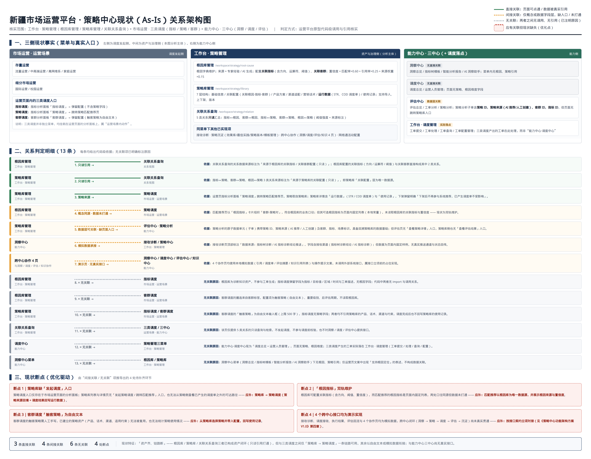
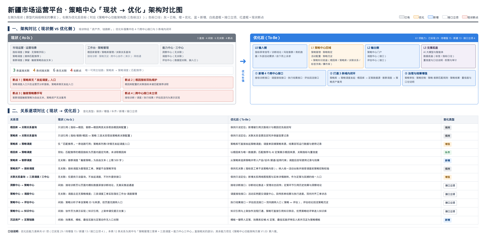

# 策略中心现状与优化架构对比说明 V1.0

> **文档定位**：以「现状（As-Is）→ 优化后（To-Be）」为主线，说明工作台 · 策略管理（根因库管理 / 策略库管理 / 关联关系查询）与市场运营 · 三类调度（指标调度 / 策略调度 / 客群调度）、能力中心 · 三中心（洞察中心 / 调度中心 / 评估中心）之间的**真实关系**；对不存在关联的组合**如实标注并说明原因**；并与《策略中心功能架构方案 V1.0》的优化后架构逐项对比。
>
> **核实方式**：菜单定义、页面跳转、数据引用（跨文件 import、页面内常量、数据模型字段）**代码级核实**；判定结论均给出可回溯的代码位置。
>
> **配套图纸**（同目录）：
> - 现状侧：`策略中心现状关系架构图-AsIs.png`
> - 对比侧：`策略中心现状与优化架构对比图.png`
> - 优化侧：`策略中心功能架构图-三色标注.png`、`策略中心智慧运营演进图-三色标注.png`
>
> **关联文档**：《策略中心优化方案 V1.0》（页面级 P1～P12 改造）、《策略中心功能架构方案 V1.0》（61 项能力清单与阶段计划）。

---

## 〇、结论速览

| 维度 | 结论 |
|---|---|
| 关系总量 | 围绕「策略管理三菜单 × 三类调度 × 三中心」共判定 **13 条关系**（另附 3 菜单 × 6 对象 = 18 格全组合矩阵，见 3.0） |
| 直接关联 | **3 条** —— 根因库→关联关系查询、策略库→关联关系查询、策略库→策略调度（匹配推荐） |
| 间接关联 | **4 条** —— 根因库→策略调度（口径同源、数据未打通）、策略库→评估中心（数据层可关联、无入口）、洞察中心→接收诊断（模拟数据承接）、跨中心协作 4 页（演示实现） |
| 无关联 | **6 条** —— 根因库→指标调度、根因库→客群调度、策略库→指标调度/客群调度、关联关系查询→三类调度与三中心、调度中心→策略管理、洞察中心菜单→根因库/策略库 |
| 现状断点 | **4 处** —— ①策略库无发起调度入口 ②根因指标双轨维护 ③触客策略靠手写 ④跨中心接口未立项 |
| 一句话结论 | 现状特点为「**资产齐、链路断**」：根因库 / 策略库 / 关联关系查询已形成资产闭环（只读引用打通），但与三类调度之间仅「策略库 → 策略调度」一条链路可用，其余以自由文本或模拟数据衔接；与能力中心三中心尚无真实接口 |

---

## 一、分析范围与核实方法

### 1.1 分析范围

| 侧 | 范围 | 说明 |
|---|---|---|
| 资产与治理侧 | 工作台 → 策略管理 → **根因库管理 / 策略库管理 / 关联关系查询** | 本次分析主体；同菜单下其余已实现项（接收诊断、策略沉淀、跨中心协作、网格通活动配置）作为关联上下文纳入 |
| 调度发起侧 | 市场运营 → 存量运营 / 细分市场运营 → 运营页面内的**指标调度 / 策略调度 / 客群调度** | 三类调度不是独立菜单，而是挂在运营页面分析面板上的动作入口 |
| 能力侧 | 能力中心 → **洞察中心 / 调度中心 / 评估中心**（含知识中心协作） | 判定与三菜单是否存在真实接口或数据引用 |

### 1.2 核实方法（逐条可回溯）

1. **菜单与路由**：以 `src/app/workspace/layout.tsx`（工作台菜单）与 `src/components/Header.tsx`（顶部导航：市场运营、能力中心）为准。
2. **真实入口**：以页面内实际按钮与跳转逻辑为准（如分析面板的调度按钮、匹配推荐页的跳转参数）。
3. **数据引用**：以跨文件 `import`、共享数据源、数据模型字段为准；页面内本地常量视为「未打通」。
4. **无关联判定标准**：两者之间**无 import、无跳转、无共享数据源、无字段引用**，即判定为无关联，并在图中以灰色点线 + 文字原因标注。

---

## 二、现状事实（三侧逐一说明）

### 2.1 资产与治理侧：工作台 · 策略管理

| 菜单 | 路由 | 核心功能 | 数据来源 | 数据消费者 | 与其他实体的现状关系 |
|---|---|---|---|---|---|
| 根因库管理 | `/workspace/strategy/root-cause` | 根因字典维护（名称/描述/一二级分类/来源）；配置**关联指标**（方向、运算符、阈值）与**关联客群**；置信度按「匹配率×0.60 + 引用率×0.25 + 来源权重×0.15」计算（来源权重：专家经验 1.0、AI 生成 0.75） | 人工录入 / 导入模板（来源字段区分专家经验与 AI 生成） | 关联关系查询（只读引用）、策略库「关联配置」层（关联根因选择项） | ↔ 关联关系查询：直接；→ 策略调度：间接（口径同源、数据未打通）；→ 指标调度 / 客群调度：无关联 |
| 策略库管理 | `/workspace/strategy/library` | 策略 7 层结构：基础信息 / 关联配置（关联根因·指标·客群）/ 产品方案 / 渠道适配 / 营销话术 / **运行数据** / **使用记录**；支持批量导入、上下架、策略版本 | 人工录入 / 导入；关联项取自根因库与标签体系 | 策略调度（匹配推荐页的策略来源）、关联关系查询（只读引用）、评估中心策略分析（数据层字段可关联） | ↔ 关联关系查询：直接；→ 策略调度：直接（唯一可用主链路）；→ 客群调度 / 指标调度：无关联；→ 评估中心：数据层可关联、无页面入口 |
| 关联关系查询 | `/workspace/strategy/relation` | 5 类关系**只读**汇总与检索：指标↔根因、客群↔根因、指标↔策略、客群↔策略、根因↔策略；含阈值强度与来源标注 | 根因库（2 类）、策略库（3 类） | 运营人员查询、定策前人工参考 | → 三类调度与三中心：无关联（不发起调度、不参与校验、不对外提供接口） |
| 接收诊断 | `/workspace/strategy/receive-diagnosis` | 承接「指标树诊断结论 / AI 指标诊断」结论，展示达成率、异常原因、建议策略数；支持受理与转已制定 | 页面内固定样例数据（标注来源为指标树诊断 / AI 指标诊断结论推送） | 策略制定环节（人工参考） | ← 洞察中心：间接（模拟数据承接，无真实推送接口） |
| 策略沉淀 | `/workspace/strategy-repository/*` | 效果库、最佳实践、策略版本、模板管理 | 原型本地数据（效果回流接口待立项） | 定策环节（现状无入口关联） | → 定策链路：间接（无入口关联） |
| 跨中心协作 | `/workspace/strategy-collab/*` | 与洞察中心 / 调度中心 / 评估中心 / 知识中心协作页（引用清单、调度单、评估摘要、知识引用） | 页面内本地模拟数据 + 操作提示文案 | ——（演示） | ↔ 三中心 / 知识中心：间接（演示实现，接口未立项） |
| 网格通活动配置 | `/workspace/strategy/grid-config` | 网格通侧活动配置 | 人工录入 | 网格通侧执行 | 属活动配置域，本次关系判定不涉及 |

### 2.2 调度发起侧：市场运营 · 三类调度

| 调度类型 | 真实入口（现状） | 关键配置字段 | 产出落点 | 与策略资产的现状关系 |
|---|---|---|---|---|
| 指标调度 | 运营页面 → 指标分析面板「指标调度」按钮 → 弹窗 | 指标、目标值、区域、时间、工单描述 | 工单体系（IND 前缀）→ 工作台 · 调度管理 | **无关联**：弹窗不含根因、策略字段 |
| 策略调度 | 运营页面 → 指标分析面板「策略调度」按钮 → 跳转 `/workspace/strategy/matching`（策略匹配推荐） | 根因指标卡片、客群-策略对、派发地州、AI 建议 | 工单体系（STR 前缀）；结果回写策略库「运行数据」 | **直接关联**：策略来源＝策略库；列表/详情无反向发起入口 |
| 客群调度 | 运营页面 → 客群分析面板「客群调度」按钮 → 弹窗 | 工单描述、**触客策略（自由文本，上限 500 字）**、重要级别、后评估周期、指标目标值、圈选标签与区域（只读） | 工单体系（CG-OP 前缀）→ 工作台 · 调度管理 | **无关联**：不读取策略库的产品、话术、渠道与约束 |

> 说明：三类调度均以「运营页面的分析面板」为唯一发起入口，市场运营菜单下**没有**独立的调度菜单；因此「市场运营 ↔ 策略中心」的衔接点只有分析面板这一处。

### 2.3 能力侧：能力中心 · 三中心

| 中心 | 现有菜单 | 与策略资产的现状关系 |
|---|---|---|
| 洞察中心 | 洞察总览 / 指标树模板 / 智能分析报告 / AI 洞察助手 | **无直接关联**：菜单内无根因、策略引用；仅在部分运营页文案中出现「支持根因定位」的表述 |
| 调度中心 | 调度总览 / 运营人员管理 | **无直接关联**：页面无策略、根因维度；三类调度产生的工单实际落在 工作台 · 调度管理 |
| 评估中心 | 评估总览 / 工单分析 / 策略分析 | **数据层可关联、缺页面入口**：策略分析的原子数据单元携带策略 ID、策略来源（AI 推荐 / 人工创建）、客群 ID、指标 ID 与场景标识，具备回溯策略库的数据基础，但页面无「查看策略」入口，策略库侧也无「查看评估结果」入口 |
| 知识中心 | 知识库管理 / 审核管理 | 经由「跨中心协作 → 与知识中心协作」页衔接，现状为演示实现 |

---

## 三、关系判定明细（13 条，含代码级依据）

### 3.0 全组合矩阵（3 菜单 × 6 对象 = 18 格，逐格标记）

> 标记口径：✅ 直接关联（页面可点通 / 数据被真实引用）｜◐ 间接关联（仅口径同源或字段层可关联，缺入口或未打通）｜✕ 无关联（无 import、无跳转、无共享数据源、无字段引用）
>
> 说明：下表 6 个对象为**菜单外对象**（三类调度 + 三中心）。三条"直接关联"中的另外 2 条（根因库→关联关系查询、策略库→关联关系查询）属于三菜单之间的只读引用，见 3.1 D-1 / D-2。

| 策略管理菜单 ＼ 对象 | 指标调度 | 策略调度 | 客群调度 | 洞察中心 | 调度中心 | 评估中心 |
|---|---|---|---|---|---|---|
| **根因库管理** | ✕ 工单无根因字段 | ◐ 口径同源、未打通（匹配推荐根因指标为页面内固定列表） | ✕ 圈选与配置均不读根因库 | ◐ 仅"接收诊断"页模拟承接；置信度中"匹配率"分母口径指向指标监测侧 | ✕ 根因不进入工单承接环节 | ✕ 置信度 / 验证状态非评估回流值 |
| **策略库管理** | ✕ 管理类工单不含策略字段 | ✅ 策略来源＝策略库；运行数据 / 使用记录回填 | ✕ 触客策略为自由文本（≤500 字） | ◐ "关联根因"字典级指向根因，洞察侧无反向引用 | ◐ 删除提示保留调度单快照，无明细页与接口 | ◐ 评估子单含策略 ID / 策略来源，无双向跳转入口 |
| **关联关系查询** | ✕ 不参与调度前校验 | ✕ 不作为匹配推荐的匹配依据（推荐用页面内本地数据） | ✕ 不被客群调度引用 | ✕ 不对洞察中心提供阈值 | ✕ 不对调度中心提供关系 | ✕ 不对评估中心提供归因映射 |

**矩阵小结**：6 个对象 × 3 个菜单共 18 格 —— ✅ 1 格、◐ 5 格、✕ 12 格。即：**现状只有 1 条真实链路（策略库 → 策略调度）**，另有 5 处"口径或字段层可关联但链路未通"，其余 12 格完全独立。

> 口径提示：本表按「菜单 × 对象」**逐格**判定，而 3.1～3.3 按「关系项」**归并**（如"根因库 → 策略调度"与"根因库 → 洞察中心"在 3.2 中分别对应 I-1 与 I-3，条数口径不同属正常）。

### 3.1 直接关联（3 条）

| 编号 | 关系项 | 关系说明 | 代码级依据 |
|---|---|---|---|
| D-1 | 根因库管理 → 关联关系查询 | 只读引用：关联关系查询中「指标↔根因」「客群↔根因」两类关系的数据来源即根因库的关联指标 / 关联客群配置 | 关联关系查询页关系类型定义中标注「来源于根因库的关联指标配置（只读）」；根因库配置项含关联指标（变化方向、运算符、阈值）与关联客群 |
| D-2 | 策略库管理 → 关联关系查询 | 只读引用：「指标↔策略」「客群↔策略」「根因↔策略」三类关系的数据来源即策略库「关联配置」层 | 关联关系查询页关系类型定义中标注「来源于策略库的关联配置（只读）」；策略库详情页含「关联配置」Tab（关联根因 / 关联指标 / 关联客群） |
| D-3 | 策略库管理 → 策略调度 | 策略为策略调度的策略来源；调度结果回写策略库 | 运营页指标分析面板「策略调度」跳转策略匹配推荐页，策略取自策略库；策略库详情页含「运行数据」（STR / COD 调度单）与「使用记录」；下架弹窗提示「下架后不再参与系统推荐，但已产生的调度单不受影响」 |

### 3.2 间接关联（4 条）

| 编号 | 关系项 | 关系说明 | 代码级依据 |
|---|---|---|---|
| I-1 | 根因库管理 → 策略调度 | 业务口径同源、数据未打通：匹配推荐页以「根因指标」卡片组织「客群-策略对」，与根因库的业务口径一致；但其可选根因指标为页面内固定列表，未读取根因库的关联指标与置信度 → 形成双轨维护 | 匹配推荐页根因指标列表为页面内本地常量（含指标名与方向），未引用根因库数据源；根因库里已配置的「关联指标」未在匹配推荐中作为候选来源出现 |
| I-2 | 策略库管理 → 评估中心 · 策略分析 | 数据层可关联、页面缺入口：评估子单携带策略 ID、策略来源（AI 推荐 / 人工创建）、客群 ID、指标 ID，具备回溯能力；但评估页无「查看策略详情」入口，策略库侧亦无「查看评估结果」入口 | 策略分析页子单数据结构包含策略标识、策略来源、客群标识、预警指标标识、问题子指标标识与场景标识 |
| I-3 | 洞察中心 → 接收诊断（策略中心） | 模拟数据承接：接收诊断页承接「指标树诊断结论 / AI 指标诊断」，但数据为页面内固定样例，无真实推送通道与受理状态回传 | 接收诊断页标注「数据来源：指标树诊断 / AI 指标诊断结论推送」，字段含接收渠道（指标树诊断结论 / AI 指标诊断）；数据为页面内固定样例 |
| I-4 | 跨中心协作 4 页 → 三中心 / 知识中心 | 演示实现：与洞察、调度、评估、知识四类协作页均使用本地模拟数据与操作提示文案，未调用外部系统接口 | 四个协作页分别使用页面内本地数据（指标树模板引用清单、调度单、评估摘要、知识引用清单），操作后仅展示提示文案 |

### 3.3 无关联（6 条，附原因）

| 编号 | 组合 | 无关联原因 |
|---|---|---|
| N-1 | 根因库管理 → 指标调度 | 根因库为诊断知识资产，不参与工单生成；指标调度弹窗字段为指标 / 目标值 / 区域 / 时间与工单描述，无根因字段；两者之间无 import 与调用 |
| N-2 | 根因库管理 → 客群调度 | 客群调度弹窗的圈选来自客群标签与区域，配置项为触客策略（自由文本）、重要级别、后评估周期与指标目标值，不读取根因库 |
| N-3 | 策略库管理 → 指标调度 / 客群调度 | 指标调度无策略字段；客群调度的「触客策略」为自由文本输入（上限 500 字），不引用策略库的产品、话术、渠道与适用约束，调度完成后也不回写策略库的使用记录与运行数据 |
| N-4 | 关联关系查询 → 三类调度 / 三中心 | 该页仅提供 5 类关系的只读查询与检索，不发起调度、不参与调度前校验，也不对洞察 / 调度 / 评估中心提供接口 |
| N-5 | 调度中心（能力中心）→ 策略管理三菜单 | 能力中心 · 调度中心现为「调度总览 + 运营人员管理」，页面无策略、根因维度；三类调度产生的工单实际落在工作台 · 调度管理（工单提交 / 处理 / 查询 / 配置） |
| N-6 | 洞察中心菜单 → 根因库 / 策略库 | 洞察中心（洞察总览 / 指标树模板 / 智能分析报告 / AI 洞察助手）菜单内无根因、策略引用；仅部分运营页文案出现「支持根因定位」的表述，不构成数据关联 |

---

## 四、现状架构图（As-Is）

**读图说明**

1. **四个分区**：三侧现状事实（菜单与真实入口）→ 关系判定明细（13 条，逐条给依据）→ 现状断点（4 处）→ 小结（关系统计与结论）。
2. **四类线型**：绿色实线＝直接关联（页面可点通 / 数据被真实引用）；橙色虚线＝间接关联（仅概念或数据字段层，缺入口或未打通）；灰色点线＝无关联（已注明原因）；红色虚线框＝应有关联但现状缺失（优化点）。
3. **关键读法**：先看「策略管理三菜单」这一列，向下核对每条出线；凡进入「市场运营 · 三类调度」与「能力中心 · 三中心」的连线，都必须能在原型中找到可点通的路径或被引用的数据源。

---

## 五、与优化后架构的对比

### 5.1 对比图

对比图左侧为现状侧（关系统计 + 4 处断点），右侧为优化后侧（五层架构 + 三类补强）；下方为 12 条关系逐项对比（关系项 / 现状 / 优化后 / 变化类型，不含落地期次）。分期安排不在图中呈现，统一见本文第六章与本方案第九章文字说明。

### 5.2 关系逐项对比（12 条）

| 关系项 | 现状（As-Is） | 优化后（To-Be） | 变化类型 | 期次 |
|---|---|---|---|---|
| 根因库 → 关联关系查询 | 只读引用（指标↔根因、客群↔根因） | 保持只读定位；新增被引用次数统计与根因优先级回写 | 保持 | 一期 |
| 策略库 → 关联关系查询 | 只读引用（指标 / 客群 / 根因 ↔ 策略） | 保持只读定位；关联关系变更后回写并保留变更记录 | 保持 | 一期 |
| 策略库 → 策略调度 | 仅「匹配推荐」一条链路，策略库侧无发起入口 | 策略库可直接发起策略调度；调度单回填策略来源，结果回写运行数据与使用记录 | 增强 | 一期 |
| 根因库 → 策略调度 | 双轨：匹配推荐根因指标为页面内固定列表 | 以根因库为唯一数据源；匹配推荐与 AI 定策展示根因来源、关联指标与置信度 | 补齐 | 二期 |
| 策略库 → 客群调度 | 无关联：触客策略为自由文本 | 从策略库选择策略并带入产品 / 话术 / 渠道 / 适用约束；调度后回写使用记录与效果 | 新增 | 二期 |
| 策略资产 → 指标调度 | 无关联：指标调度为管理类工单，不含策略字段 | 保持无关联（指标类工单不含策略内容）；纳入统一活动台账并接受调度前策略控制校验 | 保持 | 三期 |
| 关联关系查询 → 三类调度 / 三中心 | 无关联：仅只读查询 | 保持只读定位；新增关系网络图视图与实体详情跳转，作为定策与回溯的统一入口 | 增强 | 二期 |
| 洞察中心 → 策略中心 | 间接：接收诊断页以模拟数据承接 | 接收诊断接口：诊断结论推送 + 受理状态回传；定策引用历史效果与洞察结论 | 接口立项 | 四期 |
| 策略中心 → 调度中心 | 无关联：调度总览无策略维度 | 调度接收接口：活动实例提交调度中心，回传拆单结果与执行进度，双向对齐工单状态 | 接口立项 | 四期 |
| 策略中心 → 评估中心 | 间接：子单含策略 ID 与来源，无跳转入口 | 执行结果接口 + 评估回流接口 + 双向跳转入口（策略 ↔ 评估） | 接口立项 | 四期 |
| 策略中心 ↔ 知识中心 | 间接：协作页为演示实现 | 知识引用与上架协作流程打通，策略可直接引用知识条目，优秀策略经评审进入知识库 | 接口立项 | 四期 |
| 沉淀资产 → 定策链路 | 间接：效果库 / 模板 / 最佳实践与定策动作无入口关联 | 模板一键带入定策、效果库反哺 AI 定策、最佳实践评审后入库并沉淀为策略模板 | 新增 | 一期 / 二期 |

**变化归类**：保持 3 条 · 增强 2 条 · 补齐 1 条 · 新增 2 条 · 接口立项 4 条。

> **口径对齐**：优化后能力清单共 61 项（已实现 29 / 待增强 15 / 新建 13 / 接口立项 4），上表 12 条为其中与「策略管理三菜单 × 三类调度 × 三中心」直接相关的部分；能力全景见《策略中心功能架构方案 V1.0》第六章。

### 5.3 与四期分期的对应

| 期次 | 内容 | 覆盖的对比项 |
|---|---|---|
| 第一期 · 链路补齐 | 策略中心总览改造、定策五步链路、历史效果参照、**策略库发起调度**、模板一键带入定策、AI 复盘 | 策略库 → 策略调度（增强）；沉淀资产 → 定策链路（新增） |
| 第二期 · 资产复用与比选 | 活动配置统一页与活动实例、策略审批、AI 定策与方案比选、**根因库作为定策数据源**、**客群调度复用策略**、关联关系回写、置信度与口径展示 | 根因库 → 策略调度（补齐）；策略库 → 客群调度（新增）；关联关系查询（增强） |
| 第三期 · 统筹与管控 | 策略统筹、策略控制、策略-客群匹配规则、空间策略输入、权限与操作审计、自下而上诉求承接 | 策略资产 → 指标调度（纳入统一台账与调度前校验） |
| 第四期 · 跨中心接口 | 接收诊断接口、调度接收接口、执行结果接口、评估回流接口（含知识中心协作） | 4 条接口立项项 |

---

## 六、优化建议（针对 4 处断点的整改项）

| 断点 | 整改动作 | 涉及页面 | 前置依赖 | 期次 | 验收标准 |
|---|---|---|---|---|---|
| ① 策略库缺「发起调度」入口 | 策略库列表与详情新增「发起策略调度」，跳转匹配推荐并自动带入当前策略；调度单回填策略来源，结果回写运行数据与使用记录 | 策略库列表 / 详情、匹配推荐页 | 无（现成能力即可实现） | 一期 | 从策略库可 2 步内发起调度；策略库「运行数据」可查到该调度单与执行进度 |
| ② 「根因指标」双轨维护 | 匹配推荐的根因指标改为读取根因库（含来源、关联指标、置信度）；AI 定策输出根因依据 | 匹配推荐页、根因库管理 | 根因库关联指标字段完整（已具备） | 二期 | 匹配推荐候选根因指标与根因库一致率 100%；定策页可追溯根因来源 |
| ③ 触客策略靠手写 | 客群调度的「触客策略」改为「从策略库选择策略 + 可补充说明」，自动带入产品、话术、渠道与适用约束；调度后回写使用记录 | 客群调度弹窗、策略库管理 | 策略库 7 层结构完整（已具备） | 二期 | 客群调度可统计所引用策略的使用次数与转化率 |
| ④ 跨中心接口未立项 | 按接口契约推进接收诊断、调度接收、执行结果、评估回流 4 个接口；协作页由演示实现切换为真实数据 | 接收诊断、4 个协作页、评估中心策略分析 | 外部系统（洞察中心 / 调度中心 / 评估中心）接口改造资源 | 四期 | 4 个接口联调通过；跨中心闭环（洞察 → 策略 → 调度 → 评估 → 沉淀）端到端可跑通 |

---

## 七、结论与风险

### 7.1 结论

1. **三菜单之间已形成资产闭环**：根因库、策略库互为关联配置来源，关联关系查询将两者以 5 类关系只读汇总，具备作为「定策统一入口」的资产基础。
2. **与三类调度只有一条真实链路**：仅「策略库 → 策略调度（匹配推荐）」可点通；指标调度与客群调度均未接入策略资产，其中客群调度的触客策略仍需人工手写。
3. **与能力中心三中心尚无真实接口**：洞察中心、调度中心在菜单与字段层面均与策略资产无关；评估中心仅存在数据层可关联性，缺少页面入口。

### 7.2 风险与依赖

| 风险 / 依赖 | 说明 | 应对 |
|---|---|---|
| 接口立项依赖外部系统 | 4 个接口需洞察 / 调度 / 评估中心配合改造，排期不完全可控 | 前三期先完成域内闭环（不依赖外部），接口期次单独管理，并保留手动导入兜底 |
| 指标调度保持「无关联」的合理性 | 指标调度面向管理类指标改善任务，其内容为指标目标值与区域分解，与策略资产（面向客户的营销策略）本质不同 | 保持不强行关联，仅通过统一活动台账与调度前策略控制实现一致性管理 |
| 双轨维护带来的口径风险 | 根因指标若长期双轨，将导致定策依据不一致 | 二期统一数据源，并以「关联关系查询」作为唯一关系视图，禁止页面内自建关系数据 |
| 演示数据带来的预期偏差 | 协作页与接收诊断页当前为模拟数据，易被误认为已贯通 | 页面明确标注数据来源与「接口待立项」，交付材料中以本说明与架构图为准 |

---

## 附录：图纸与源文件

| 类型 | 文件 |
|---|---|
| 现状关系架构图 | `docs/需求设计方案/策略中心现状关系架构图-AsIs.png` |
| 现状 vs 优化对比图 | `docs/需求设计方案/策略中心现状与优化架构对比图.png` |
| 优化后功能架构图（三色标注） | `docs/需求设计方案/策略中心功能架构图-三色标注.png` |
| 优化后智慧运营演进图（新疆版） | `docs/需求设计方案/策略中心智慧运营演进图-三色标注.png` |
| 图纸源码（可二次编辑） | `scripts/strategy-asis-diagram.html`、`scripts/strategy-compare-diagram.html`、`scripts/strategy-arch-diagram.html`、`scripts/strategy-evolution-diagram.html` |
| 渲染与校验脚本 | `scripts/render-strategy-diagrams.js`（渲染 PNG，2 倍分辨率）、`scripts/check-diagram-overflow.js`（图纸元素溢出校验） |
