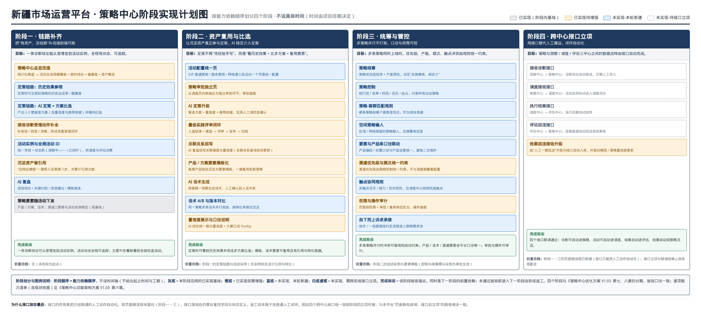

# 策略中心阶段实现计划说明 V1.0

### —— 图五《策略中心阶段实现计划图》的逐阶段文字说明

> **文档用途**：图五回答"分几个阶段、每个阶段做什么、按什么顺序"；本文是对图五的**逐条文字说明**，把图中每个小块"做什么、数据从哪来、给谁用、为什么排在这个位置、怎么与洞察 / 调度 / 评估三中心协同"讲清楚，供评审、开发排期与验收对照使用。
>
> **配套图纸**：`docs/需求设计方案/策略中心阶段实现计划图.png`（图五；可编辑源文件 `scripts/strategy-phase-plan-diagram.html`，改文字后执行 `node scripts/render-strategy-diagrams.js` 重新出图）。
>
> **关联文档**：
> - 《策略中心功能架构方案 V1.0》：61 项能力全景清单（本文所有编号均指向其第六章）；
> - 《策略中心优化方案 V1.0》：页面级改造方案（P1～P12），其第七、八章分期与本文四阶段一致；
> - 《策略中心现状与优化架构对比说明 V1.0》：现状关系与断点判定，是本文排序的现状依据。

---

## 〇、图五与读图方法

### 0.1 图五：策略中心阶段实现计划图

### 0.2 读图三步

1. **先看四色**：每一小块的颜色表示"现状"，与《功能架构方案》同一口径——灰底＝已实现（本阶段沿用的基线）、橙底＝已实现待增强、蓝底＝未实现·本轮新建、白底虚框＝未实现·待跨系统接口立项；
2. **再看横向四列**：从左到右是阶段一 → 阶段四，**列的顺序＝能力依赖顺序**（左边阶段的产出是右边阶段的输入），不是时间轴——图中不出现任何起止时间与工期，时间由项目排期决定；
3. **最后看每列底部的"完成标志"**：它是该阶段的验收锚点，同时是下一阶段的前置依赖；未通过验收就进入下一阶段，会形成返工。

### 0.3 两套"阶段"口径，不可混用

| 口径 | 出处 | 回答的问题 | 阶段划分 |
|---|---|---|---|
| 能力演进阶段 | 图二（智慧运营演进图） | 能力最终长成什么样 | 人工创建 → AI 辅助（人确认）→ AI 智慧运营 |
| 建设实施阶段 | 图五 + 本文 | 按什么顺序建、每步验收什么 | 阶段一 链路补齐 → 阶段二 资产复用与比选 → 阶段三 统筹与管控 → 阶段四 跨中心接口立项 |

两者是"目标形态"与"实施路径"的关系：阶段一～二完成后即达到图二"AI 辅助（人确认）"形态；"AI 智慧运营"形态需要阶段二的效果数据积累与阶段四的评估回流接口支撑。

### 0.4 计数口径（不新增能力项）

图五共 **31 条建设条目**（8 + 9 + 9 + 5），映射到《功能架构方案》第六章 **34 项能力编号**（对照表见第六章）；**未新增第 62 项能力**，四色计数维持 **61 项 = 灰 29 / 橙 15 / 蓝 13 / 虚 4** 不变。其中"空间策略输入"是编号 M1-9（策略-客群匹配规则）的区域 / 网格维度形态，复用区域攻坚（RAS）已实现的地图圈选能力，在图中单列展示但**不占新编号**。

---

## 一、四阶段总览

| 阶段 | 主题 | 建设条目 | 一句话目标 | 完成标志（验收锚点） | 前置依赖 |
|---|---|---|---|---|---|
| 一 | 链路补齐 | 8 条 | 把"有资产、没链路"补成端到端可跑 | 一条诊断结论可从受理走到活动实例，活动状态全程可追踪；主管可在看板看到全部在途活动 | 无（本阶段为起点） |
| 二 | 资产复用与比选 | 9 条 | 定策不再"凭经验手写"，而是"看历史效果 + 比多方案 + 复用要素" | 定策时可看到历史效果并完成多方案比选；模板、话术要素可复用且有引用与转化数据 | 阶段一的定策链路与活动实例（无实例则无法计引用与转化） |
| 三 | 统筹与管控 | 9 条 | 多策略并行不打架，口径与权限可控 | 多条策略并行时冲突可被规则自动约束；产品 / 话术 / 渠道要素全平台口径唯一；审批与操作可审计 | 阶段二的活动实例与要素模板（控制与统筹需以实例为单位生效） |
| 四 | 跨中心接口立项 | 5 条 | 用接口替代人工搬运，闭环自动化 | 四个接口联调通过：诊断可自动进策略、活动可自动进调度、结果自动进评估、效果自动回策略沉淀 | 阶段一～三的页面侧流程已跑通；接口立项与联调依赖上游系统配合 |

---

## 二、阶段一：链路补齐（8 条）

### 2.1 阶段目标与定位

现状是"**有资产、没链路**"：历史效果库、策略模板库、最佳实践库、根因库、关联关系查询都已存在（灰），但定策时看不见历史效果、活动没有全局 ID、活动状态不在一块看板上。本阶段不追求"智能化"，只把一条诊断结论到活动实例的**人工链路**打通，让后续所有阶段都有可作用的对象。

### 2.2 建设内容逐条说明

| # | 建设条目（标注） | 做什么 | 数据从哪来 | 谁消费、怎么用 |
|---|---|---|---|---|
| 1 | 策略中心总览改造（橙） | 统计仪表盘升级为活动生命周期看板 + 我的待办 + 健康度 + 资产概览 | 活动实例状态机（本表第 5 项）、待办（接收诊断与审批任务）、沉淀资产统计（模板库 / 最佳实践库已有数据） | 策略中心主管看全部在途活动与健康度；运营人员处理"我的待办"；是"全程可追踪"的展示载体 |
| 2 | 定策链路：历史效果参照（蓝） | 定策时展示相似策略的历史达成率 / 健康度 | 历史效果库（已有基线；回流数据当前由评估侧人工一键回流） | 策略制定人参照；同时作为第 3 项 AI 生成候选的输入之一 |
| 3 | 定策链路：AI 定策 + 方案比选（蓝） | 产出 2～3 套候选方案（含置信度与推荐依据）并横向比选，人工确认后进入策略编辑 | 诊断结论（接收诊断已有）、历史效果库、根因库 / 策略库 / 关联关系（已有）、AI 大模型底座（已有） | 策略制定人比选确认；确认结果写入策略编辑（已有基线），全程人可改 |
| 4 | 接收诊断受理动作补全（橙） | 补拒收 / 转派 / 忽略，形成完整受理闭环 | 洞察中心诊断结论（当前人工导入 / 页面查看；自动推送接口待立项，见阶段四） | 受理岗操作；拒收 / 转派原因页面留痕，供追溯与后续接口字段设计 |
| 5 | 活动实例与全局活动 ID（蓝） | 统一字段 + 状态机（洞察中 → 制定中 → 调度中 → 执行中 → 评估中 → 沉淀中 → 已闭环） | 定策确认动作 + 活动配置（三类活动配置已有） | 全阶段计划的枢纽：调度派单携带活动 ID（页面侧人工，接口待立项）、评估回流按活动 ID 对账、总览看板按状态统计 |
| 6 | 沉淀资产被引用（橙） | "应用此模板"一键带入定策第 ③ 步，并累计引用次数 | 策略模板管理（已有） | 定策人一键复用；引用次数供最佳实践评审（阶段二）与模板排序使用 |
| 7 | AI 复盘（蓝） | 产出成效结论 / 关键归因 / 改进建议 / 模板候选 | 效果回流数据（人工回流基线）+ 活动实例状态 | 策略沉淀岗确认；模板候选进入模板管理待审；归因结论在阶段二经"关联关系回写"更新关联强度 |
| 8 | 策略要素随活动下发（灰·基线） | 产品 / 方案、话术、渠道三要素与活动实例绑定下发——已实现，本阶段仅保证绑定关系随活动 ID 完整下发，不做改造 | 策略库第 ④～⑥ 层（推荐产品 / 方案、营销话术、渠道适配，已有） | 调度中心派单内容、触点执行侧使用 |

### 2.3 完成标志（验收口径）

一条诊断结论可从受理走到活动实例，活动状态全程可追踪；主管可在看板看到全部在途活动。**验收方式（页面侧）**：取一条真实诊断结论为样本，走通"受理 → 定策（人工或 AI 候选确认）→ 审批 → 活动配置 → 活动实例生成 → 看板状态可查"，全链路无断点、无人工二次录入。

### 2.4 为什么排第一（排序理由）

1. 后面三个阶段的所有动作都需要作用对象：资产复用需要"活动 ID 可计数"、统筹管控需要"实例可约束"、接口对接需要"字段与状态已定义"——这些都由本阶段的活动实例提供；
2. 现状断点（见《对比说明》）集中在"策略库建了但调度表单选不到策略、活动状态无处可看"，先补链路是消除断点的最短路径；
3. 本阶段以橙色增强与流程串联为主，蓝色新建仅 4 条，风险最低、见效最快，适合作为起点建立使用信任。

### 2.5 与三中心的协同方式

| 三中心 | 本阶段协同 | 现状形态 |
|---|---|---|
| 洞察中心 | 诊断结论流入策略中心 → 受理闭环（拒收 / 转派 / 忽略补全） | 人工导入 / 页面查看（接口 O-3 待立项） |
| 调度中心 | 活动实例 + 全局活动 ID 随派单进入调度待办 | 页面侧人工派单携带（接口 O-6 待立项） |
| 评估中心 | 效果数据按活动 ID 回流 → 供 AI 复盘 | 人工一键回流（接口 O-9 待立项） |

---

## 三、阶段二：资产复用与比选（9 条）

### 3.1 阶段目标与定位

阶段一让链路"能跑"，阶段二让链路"跑得聪明"：定策从"凭经验手写"变为"看历史效果 + 比多方案 + 复用要素"，同时把模板、话术、产品方案的复用变成**有计数、有转化数据**的可衡量行为。本阶段完成后，能力形态达到图二的"AI 辅助（人确认）"。

### 3.2 建设内容逐条说明

| # | 建设条目（标注） | 做什么 | 数据从哪来 | 谁消费、怎么用 |
|---|---|---|---|---|
| 1 | 活动配置统一页（蓝） | IOP 普通营销 / 剧本营销 / 网格通三类活动一个页面统一配置 | 活动实例的类型字段 + 三类活动现有配置项归并 | 活动配置岗一次配齐；统一结构写回活动实例，消除三入口口径不一 |
| 2 | 策略审批独立页（橙） | 从调度页内嵌抽出为独立审批环节，审批留痕 | 待审策略（定策确认后产生）+ 审批人角色 | 审批岗独立行使审批；结论回写策略状态（版本与上下架已有基线） |
| 3 | AI 定策升级（橙） | 候选方案 + 置信度 + 推荐依据，支持人工调优后确认 | 阶段一首版 AI 定策 + 最佳实践库 + 要素模板（本表第 4、6 项） | 策略制定人调优确认；候选质量随资产积累持续提升 |
| 4 | 最佳实践评审闭环（橙） | 入选标准 + 候选 → 评审 → 发布 → 归档 | AI 复盘结论 + 模板引用次数 + 转化数据 | 评审岗评审发布；发布后进入最佳实践库供定策引用 |
| 5 | 关联关系回写（橙） | AI 复盘回写关联强度与置信度，关联关系查询自动更新 | AI 复盘归因结论 | 关联关系查询（现状为 5 类只读视图）数据随复盘自动更新；回写结果作为下一轮定策的推荐依据 |
| 6 | 产品 / 方案要素模板化（橙） | 高频产品组合沉淀为要素模板，一键复用到新策略 | 策略库第 ④ 层产品 / 方案配置 + 历史活动使用频次 | 定策第 ③ 步一键带入；为阶段三"要素与产品库口径联动"提供模板载体 |
| 7 | AI 话术生成（橙） | 按客群 / 场景生成话术，人工确认后入话术库 | 客群标签（数据底座）+ 话术模板（已有）+ AI 底座（已有） | 话术运营确认入库；随活动实例下发到触点 |
| 8 | 话术 A/B 与版本对比（蓝） | 同一策略多条话术并行投放，按转化率择优沉淀 | 执行转化数据（评估回流，人工基线） | 话术库版本管理；择优结果供后续定策默认带出 |
| 9 | 置信度展示与口径说明（橙） | AI 结论统一展示置信度 + 计算口径 Tooltip | 与根因库现有置信度算法同源（匹配率 × 0.60 + 引用率 × 0.25 + 来源权重 × 0.15），本条只统一**展示层**，不新增算法 | 一线与管理者理解 AI 结论可信度，建立使用信任 |

### 3.3 完成标志（验收口径）

定策时可看到历史效果并完成多方案比选；模板、话术要素可复用且有引用与转化数据。**验收方式**：同一诊断场景下完成一次"参照历史 → AI 出候选 → 比选 → 复用要素模板 → 审批"的完整定策，并在模板详情可见引用次数、在话术 A/B 中可见转化对比。

### 3.4 为什么排第二（排序理由）

复用要有被复用的载体：阶段一先让模板"能被引用"（应用此模板 + 计数）、活动"有 ID 可追踪"，本阶段才有引用次数、转化数据可用，最佳实践评审才有评选依据。若不先补链路就做评审闭环，评选只能靠人工填报，无法服众。

### 3.5 与三中心的协同方式

| 三中心 | 本阶段协同 | 现状形态 |
|---|---|---|
| 洞察中心 | AI 定策候选的推荐依据引用根因库 / 关联关系；复盘结论经回写更新关联强度 | 页面内引用（关联关系查询现状为只读视图） |
| 调度中心 | 统一配置页产出的活动实例结构更规范，派单内容含要素模板 | 页面侧人工（接口 O-6 待立项） |
| 评估中心 | A/B 转化与效果回流数据进入话术择优与最佳实践评选 | 人工一键回流（接口 O-9 待立项） |

## 四、阶段三：统筹与管控（9 条）

### 4.1 阶段目标与定位

前两个阶段解决"一条策略能不能跑通"，本阶段解决"**多条策略并行时不打架**"：优先级、产能、频次、触点冲突由规则统一约束，产品 / 话术 / 渠道要素全平台口径唯一，审批与操作可审计。这是从"能用"到"可运营"的分水岭。

### 4.2 建设内容逐条说明

| # | 建设条目（标注） | 做什么 | 数据从哪来 | 谁消费、怎么用 |
|---|---|---|---|---|
| 1 | 策略统筹（蓝） | 策略优先级排序 + 产能预估，决定"先做哪条、做多少" | 在途活动实例（数量 / 类型 / 目标区域）+ 渠道产能配置 | 策略主管排产；排序结果作为派发依据 |
| 2 | 策略控制（蓝） | 防打扰 / 名单 / 时段 / 互斥 / 抢占，约束所有出站策略 | 名单库（数据底座）+ 在途活动实例 | 出站前规则校验：命中拦截的策略进入待处理，人工裁决后放行或废弃 |
| 3 | 策略-客群匹配规则（蓝） | 哪条策略给哪个客群显性化，作为派发依据 | 客群标签 + 策略适用约束（策略库第 ③ 层已有） | 派发岗执行；客群调度（CG-OP）圈选时按规则过滤 |
| 4 | 空间策略输入（蓝） | 区域 / 网格维度的策略输入，支撑属地攻坚 | 区域攻坚（RAS）地图圈选结果 + 地市 / 网格组织树 | 属地攻坚场景按圈选范围生成策略输入（编号映射见第六章） |
| 5 | 要素与产品库口径联动（蓝） | 产品编码 / 优惠口径与产品运营统一，避免二次维护 | 产品运营域产品库（唯一维护方） | 策略侧只引用不维护；引用即保证口径唯一 |
| 6 | 渠道优先级与频次统一约束（橙） | 渠道优先级由策略控制统一约束，不与调度侧重复配置 | 策略控制规则（本表第 2 项） | 调度中心选触点时的唯一优先级来源，消除两侧配置冲突 |
| 7 | 触点协同规则（蓝） | 多触点互斥 / 接力 / 优先规则，交调度中心按规则选触点 | 触点注册信息 + 策略控制规则 | 调度中心按规则自动选触点，避免多触点重复触达同一客户 |
| 8 | 权限与操作审计（橙） | 页面级权限 + 审批 / 复核岗位区分，操作留痕 | 组织与角色数据 + 操作日志 | 管理者审计；满足"谁批准、谁执行、谁修改"可追溯要求 |
| 9 | 自下而上诉求承接（蓝） | 地市 / 一线提报按约定流程进入策略需求池 | 一线提报表单 | 需求池与自上而下诊断结论同池排序，进入统筹排产 |

### 4.3 完成标志（验收口径）

多条策略并行时冲突可被规则自动约束；产品 / 话术 / 渠道要素全平台口径唯一；审批与操作可审计。**验收方式**：构造两条目标客群重叠、时段冲突的策略同时出站，验证互斥 / 频次规则自动拦截并留痕；抽查任一活动可回溯完整审批与操作记录。

### 4.4 为什么排第三（排序理由）

管控规则必须作用在"实例"上：阶段一才有活动实例、阶段二才有统一配置页与要素模板。没有实例载体，互斥 / 频次 / 优先级都无从判断；没有要素模板，"口径唯一"也没有统一的引用对象。此外管控会降低出站灵活度——在链路未跑通、价值未被验证前先加管控，会放大一线阻力。

### 4.5 与三中心的协同方式

| 三中心 | 本阶段协同 | 现状形态 |
|---|---|---|
| 洞察中心 | 自下而上诉求与诊断结论同池统筹；控制规则不改变诊断流入方式 | 人工导入（接口 O-3 待立项） |
| 调度中心 | 出站策略统一过控制规则；触点选择按触点协同规则执行 | 页面侧规则先行，接口 O-6 待立项 |
| 评估中心 | 统筹排产的目标值作为效果评估对账基准 | 页面侧人工（接口 O-9 待立项） |

---

## 五、阶段四：跨中心接口立项（5 条）

### 5.1 阶段目标与定位

把阶段一～三已跑通的**人工动作**换成**接口自动化**：诊断自动进策略、活动自动进调度、结果自动进评估、效果自动回策略。四个接口均为白底虚框（待接口立项）；页面侧在阶段一已按接口字段预留（受理动作、活动实例字段、回流对账字段），因此接口落地时页面不返工。

### 5.2 建设内容逐条说明

| # | 建设条目（标注） | 做什么 | 数据从哪来 | 谁消费、怎么用 |
|---|---|---|---|---|
| 1 | 接收诊断接口（虚框） | 洞察中心 → 策略中心：诊断结论自动推送，无需人工导入 | 洞察中心诊断结论 | 策略中心受理队列自动新增，受理动作沿用阶段一闭环 |
| 2 | 调度接收接口（虚框） | 策略中心 → 调度中心：活动实例自动进入调度待办 | 活动实例（含全局活动 ID 与三要素） | 调度中心待办自动新增，执行侧无需人工搬运 |
| 3 | 执行结果接口（虚框） | 调度中心 → 评估中心：执行结果自动回传 | 调度中心执行明细 | 评估中心自动生成评估任务，消除人工导出导入 |
| 4 | 评估回流接口（虚框） | 评估中心 → 策略中心：效果数据自动回流至效果库 | 评估中心效果结论 | 历史效果库自动更新，直接服务"历史效果参照" |
| 5 | 效果回流接收升级（橙） | 由"人工一键回流"升级为接口自动入库，并驱动根因 / 策略置信度更新 | 接口 4 回流数据 | 根因库 / 策略置信度随真实效果自动校准，关联强度持续修正 |

### 5.3 完成标志（验收口径）

四个接口联调通过：诊断可自动进策略、活动可自动进调度、结果自动进评估、效果自动回策略沉淀。**验收方式**：以一条诊断结论为样本做全链路自动化演练，四段流转均无人工搬运，且全局活动 ID 在四中心全程一致。

### 5.4 为什么接口放在最后（排序理由）

接口的作用是把**已经跑通的人工动作**自动化。若页面侧流程未固化（阶段一～三），接口落地后仍需反复修改字段与状态定义，返工成本高于先跑通人工闭环；且接口立项与联调依赖洞察 / 调度 / 评估三中心所在上游系统配合，排期不受本平台单方控制，并行推进只会互相等待。因此统一放到阶段四立项对接，与本平台"页面侧先就绪、接口后立项"的既有做法一致。

---

## 六、阶段 × 能力项对照表（映射《功能架构方案》第六章 61 项编号）

### 6.1 进入建设条目的 34 项

> 图五 31 条建设条目 ↔ 34 项编号。两处合并说明：阶段一"沉淀资产被引用"＝ M4-5（页面动作）+ L0-6（输入侧反哺口径）；"策略要素随活动下发"为 3 项基线要素 E-1 / E-4 / E-7 的绑定下发；"空间策略输入"映射 M1-9 属地形态，不占新编号。

| 阶段 | 图中建设条目 | 标注 | 对应编号 | 备注 |
|---|---|---|---|---|
| 一 | 策略中心总览改造 | 橙 | O-1 | 输出侧门户升级为看板 |
| 一 | 定策链路：历史效果参照 | 蓝 | M2-3 | 定策第 ② 步 |
| 一 | 定策链路：AI 定策 + 方案比选 | 蓝 | M2-4 + M2-5 | 图中合为一条，含两编号 |
| 一 | 接收诊断受理动作补全 | 橙 | M2-2 | 基于已具备的 M2-1（受理 / 批量受理）补全动作 |
| 一 | 活动实例与全局活动 ID | 蓝 | M3-5 | 全计划枢纽条目 |
| 一 | 沉淀资产被引用 | 橙 | M4-5 + L0-6 | 页面动作 + 输入侧口径合并 |
| 一 | AI 复盘 | 蓝 | M4-3 | 沉淀闭环起点 |
| 一 | 策略要素随活动下发 | 灰 | E-1 / E-4 / E-7 | 三要素基线，仅保证随活动 ID 完整下发 |
| 二 | 活动配置统一页 | 蓝 | M3-4 | 归并 M3-1 / M3-2 / M3-3 三入口 |
| 二 | 策略审批独立页 | 橙 | M1-4 | 独立环节 + 留痕 |
| 二 | AI 定策升级 | 橙 | M1-2 | 候选 + 置信度 + 人工调优 |
| 二 | 最佳实践评审闭环 | 橙 | M4-6 | 候选 → 评审 → 发布 → 归档 |
| 二 | 关联关系回写 | 橙 | K-2 | 关联关系查询由只读升级为随复盘更新 |
| 二 | 产品 / 方案要素模板化 | 橙 | E-2 | 要素复用载体 |
| 二 | AI 话术生成 | 橙 | E-5 | 人工确认后入库 |
| 二 | 话术 A/B 与版本对比 | 蓝 | E-6 | 转化率择优 |
| 二 | 置信度展示与口径说明 | 橙 | B-3 | 展示层统一，不新增算法 |
| 三 | 策略统筹 | 蓝 | M1-7 | 优先级 + 产能预估 |
| 三 | 策略控制 | 蓝 | M1-8 | 五类约束规则 |
| 三 | 策略-客群匹配规则 | 蓝 | M1-9 | 派发依据显性化 |
| 三 | 空间策略输入 | 蓝 | M1-9（属地形态） | 复用 RAS 地图圈选，不新增编号 |
| 三 | 要素与产品库口径联动 | 蓝 | E-3 | 产品编码口径唯一 |
| 三 | 渠道优先级与频次统一约束 | 橙 | E-8 | 策略控制统一约束 |
| 三 | 触点协同规则 | 蓝 | E-9 | 互斥 / 接力 / 优先 |
| 三 | 权限与操作审计 | 橙 | B-4 | 权限 + 留痕 |
| 三 | 自下而上诉求承接 | 蓝 | L0-7 | 需求池同池排序 |
| 四 | 接收诊断接口 | 虚框 | O-3 | 洞察 → 策略 |
| 四 | 调度接收接口 | 虚框 | O-6 | 策略 → 调度 |
| 四 | 执行结果接口 | 虚框 | O-8 | 调度 → 评估 |
| 四 | 评估回流接口 | 虚框 | O-9 | 评估 → 策略 |
| 四 | 效果回流接收升级 | 橙 | M4-2 | 接口化 + 驱动置信度更新 |

（表中"一 / 二 / 三 / 四"为阶段序号。）

### 6.2 未进入建设条目的 27 项（基线或底座，不施工）

| 分组 | 编号 | 不进入条目的理由 |
|---|---|---|
| 输入侧基线 | L0-1 ～ L0-5（5 项） | 指标信号 / 诊断结论 / 风险客群 / 商机 / 外部工单五类输入页面已具备，阶段一在其上补受理动作（M2-2），输入本身不改造 |
| 策略管理基线 | M1-1、M1-3、M1-5、M1-6（4 项） | 对接洞察、手动配置、版本上下架、7 层结构均为已实现能力，仅被引用或被增强（如 M1-2 / M1-4） |
| 定策步骤基线 | M2-1、M2-6、M2-7（3 项） | 受理、策略编辑、可视化编辑器已实现；AI 定策（M2-4）产出最终仍落入 M2-6 编辑确认 |
| 活动配置基线 | M3-1、M3-2、M3-3（3 项） | 三类活动配置已实现，由阶段二 M3-4 统一页归并入口，配置能力本身保留 |
| 沉淀基线 | M4-1、M4-4（2 项） | 历史效果库、模板管理已实现，作为"历史效果参照""应用此模板"的数据来源被消费 |
| 知识底座基线 | K-1、K-3、K-4、K-5（4 项） | 根因库、标签字典、市场事件、知识库已实现；仅 K-2（关联回写）进入阶段二 |
| 输出侧基线 | O-2、O-4、O-5、O-7（4 项） | 剧本入口、五类调度、出站提交、效果评估已实现；四接口（O-3 / O-6 / O-8 / O-9）为唯一待立项项 |
| 底座 | B-1、B-2（2 项） | B-1（AI 大模型 / 智能体接入，橙）不单列条目：其增强随阶段一"AI 定策"、阶段二"AI 定策升级 / AI 话术生成"一并落地使用；B-2（数据底座，灰）为基线 |

> 34 + 27 = 61，与《功能架构方案》第六章计数一致；四色分布（灰 29 / 橙 15 / 蓝 13 / 虚 4）不受影响。

---

## 七、排序逻辑汇总（为什么这么排）

| 问题 | 结论 | 依据 |
|---|---|---|
| 为什么不设时间轴 | 只给"能力依赖顺序 + 完成标志"，时间由项目排期决定 | 完成标志是可验收锚点，比工期承诺更可执行；排期取决于立项与资源，不属于方案层承诺 |
| 为什么链路补齐排第一 | 后续一切复用、管控、接口都以"活动实例 + 全局 ID"为作用对象 | 现状断点（策略选不到、状态无处看）全在链路上；先补链路是消除断点的最短路径 |
| 为什么资产复用排第二 | 复用需要可计数的载体（引用次数、转化数据），载体由阶段一提供 | 无活动 ID 则引用与转化无法归因，评审闭环会退化为人工填报 |
| 为什么统筹管控排第三 | 管控规则必须作用在实例与要素模板上，且应在价值验证后再加约束 | 链路未通先加管控会放大一线阻力；实例与模板分属阶段一 / 二产出 |
| 为什么接口放最后 | 接口是把已跑通的人工动作自动化；流程未固化就接口化会反复改字段 | 依赖上游三中心配合，排期不受本平台单方控制；与"页面侧先就绪、接口后立项"既有做法一致 |

---

## 八、与其他文档、图纸的关系

| 文档 / 图纸 | 与本文的关系 |
|---|---|
| 《策略中心功能架构方案 V1.0》 | 本文条目是其第六章 61 项能力的**施工排序视图**；所有编号以其第六章为准 |
| 《策略中心优化方案 V1.0》 | 其第七、八章分期与本文四阶段口径一致，不产生第二套口径 |
| 《策略中心现状与优化架构对比说明 V1.0》 | 现状关系与 4 处断点判定，是本文"为什么排这里"的现状依据 |
| 图二（智慧运营演进图） | 阶段 ①②③（能力演进）与本文阶段一～四（建设实施）的对应关系见本文 0.3 |
| 图三 / 图四（现状与对比图） | 提供各条目"现状色"的判定依据 |
| 图五（阶段实现计划图 PNG） | 本文的配套图纸；源文件 `scripts/strategy-phase-plan-diagram.html` |

---

## 九、口径统一声明

1. 本文**不新增能力项**：31 条建设条目映射 34 项编号，61 项总数与四色计数（灰 29 / 橙 15 / 蓝 13 / 虚 4）保持不变；
2. "空间策略输入"为 M1-9 的区域 / 网格维度形态（属地攻坚），复用区域攻坚（RAS）已实现能力，在图中单列展示但**不占新编号**；
3. 所有"完成标志"为验收锚点并互为前置依赖，未通过验收进入下一阶段即形成返工；时间排期由项目立项决定，本文与图五均不承诺工期；
4. 置信度口径沿用根因库现有算法（匹配率 × 0.60 + 引用率 × 0.25 + 来源权重 × 0.15），阶段二 B-3 仅统一展示层，不新增算法；
5. 四接口（O-3 / O-6 / O-8 / O-9）的报文字段以《功能架构方案》四接口契约为准，本文不重复定义。
