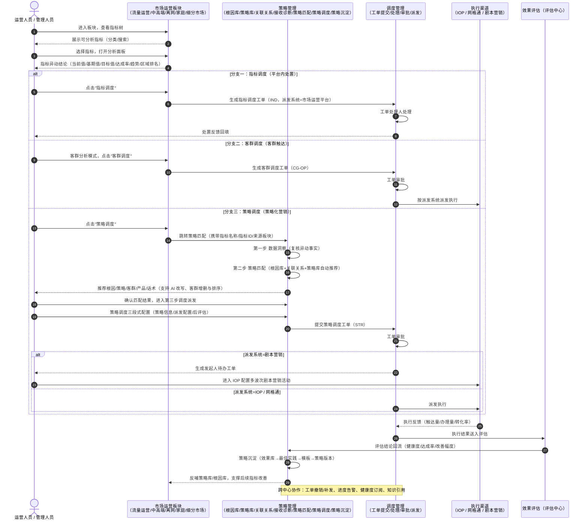
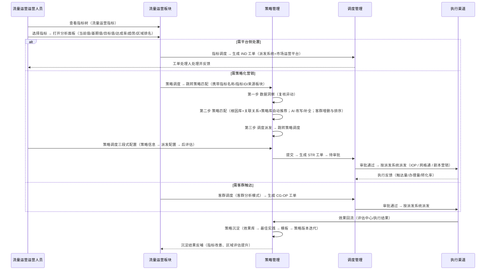

# 策略管理与市场运营调度体系关系及数据流转分析（以流量运营为例）

> 分析对象：我的工作台 → 策略管理 与 市场运营（流量运营 / 中高端运营 / 离网维系 / 家庭运营 / 细分市场）中 指标调度 / 策略调度 / 客群调度 的功能关系与数据流转。
> 场景示例：流量运营。

---

## 一、分析范围与角色定位

| 侧 | 位置 | 定位 | 核心内容 |
|---|---|---|---|
| 业务场景侧 | 市场运营（运营总览 / 存量运营：流量运营、中高端运营、离网维系、家庭运营 / 细分市场：国际运营、校园运营 / 语音运营 / 增量运营） | **发现问题、发起动作** | 指标树分析 → 指标调度 / 策略调度 / 客群调度 |
| 策略供给侧 | 我的工作台 → 策略管理 | **知识供给、策略加工、沉淀复用** | 根因库管理、策略库管理、关联关系查询、接收诊断、策略沉淀（效果库 / 最佳实践 / 策略版本 / 模板管理）、跨中心协作（洞察 / 调度 / 评估 / 知识中心）、网格通活动配置 |
| 执行流转侧 | 我的工作台 → 调度管理 | **工单流转、闭环执行** | 工单提交、工单处理、调度查询、督办管理、我的督办、流程配置 |

**一句话关系**：市场运营各板块是"需求发起方"，策略管理是"策略与知识供给方"，调度管理是"执行与闭环方"；三类调度（指标 / 策略 / 客群）是市场运营动作进入策略管理与调度体系的**唯一入口**。

---

## 二、功能关系逻辑

### 2.1 总体关系图（交互时序）



### 2.2 策略管理各模块与三类调度的支撑关系

| 策略管理模块 | 对指标调度 | 对策略调度 | 对客群调度 |
|---|---|---|---|
| 根因库管理 | 提供异动原因候选 | **核心**：策略匹配按根因置信度 / 验证状态推荐根因 | 提供客群相关根因 |
| 策略库管理 | — | **核心**：提供可选策略、推荐产品、营销话术、渠道适配 | 提供客群适用策略 |
| 关联关系查询 | 指标与根因的关系 | **核心**：指标↔根因↔策略链路 + 阈值过滤驱动自动匹配 | 客群↔根因 / 客群↔策略关系 |
| 接收诊断 | 承接指标树诊断结论 | 诊断结论"制定策略"直接进入策略匹配 | 承接客群维度诊断 |
| 策略沉淀 | 效果回流至区域评估 | **核心**：策略效果入库、优秀策略转最佳实践 / 模板、版本迭代 | 客群策略效果沉淀 |
| 跨中心协作 | 与洞察中心协作 | 与调度中心协作（工单撤销 / 补发 / 进度告警） | 与评估中心协作（健康度告警订阅） |
| 网格通活动配置 | — | 为"网格通"派发渠道预置活动配置 | 同 |

### 2.3 三类调度能力对比

| 维度 | 指标调度 | 策略调度 | 客群调度 |
|---|---|---|---|
| 发起入口 | 市场运营各板块指标分析面板"指标调度" | 分析面板"策略调度"、指标卡快捷入口、接收诊断"制定策略" | 客群分析面板"客群调度" |
| 前置数据 | 指标异动值 | 指标异动 + 根因 / 策略匹配结果 | 客群圈选结果 |
| 配置方式 | 弹窗（流程较短） | 独立页面三段式（策略信息 → 派发配置 → 后评估） | 弹窗（三步） |
| 工单前缀 | IND | STR | CG-OP |
| 派发系统 | 市场运营平台（本系统处理） | IOP / 网格通 / 剧本营销（三选一） | IOP / 网格通 / 剧本营销（三选一） |
| 剧本营销特殊规则 | — | 审批通过后不自动派发，给发起人生成待办工单，跳转 IOP 配置多波次剧本营销 | 同 |
| 后评估 | 支持 | 月指标周期 | 月指标周期 |
| 处理路径 | 我的工作台→调度管理→工单处理 | 工单处理（审批）→ 渠道执行 | 工单处理（审批）→ 渠道执行 |
| 结果沉淀 | 效果评估 → 区域评估改善 | 效果评估 → 效果库 / 最佳实践 / 版本 | 效果评估 → 策略沉淀 |

### 2.4 各市场运营板块调度能力现状

| 板块 | 指标分析（指标树 + 分析面板） | 指标调度 | 策略调度 | 客群调度 |
|---|---|---|---|---|
| 流量运营 | 支持 | 支持（弹窗） | 支持（跳策略匹配） | 支持（客群分析模式） |
| 中高端运营 | 支持 | 支持 | 支持 | 支持 |
| 离网维系 | 支持 | 支持 | 支持（指标卡快捷入口） | 支持 |
| 家庭运营 | 支持 | 支持 | 支持 | 支持 |
| 国际运营（细分市场） | 支持 | 支持 | 支持（指标卡快捷入口） | 支持 |
| 语音运营 | 支持 | 支持 | 支持（指标卡快捷入口） | 支持 |
| 增量运营 | 支持 | 支持 | 支持 | 支持 |
| 校园运营 | 待补充 | 待补充 | 待补充 | 待补充 |
| 驾驶舱（全域态势） | 支持（运营弹窗） | 支持 | 支持 | 支持 |

> 说明：上述"快捷入口"指无需进入分析面板，直接在指标卡上发起策略调度并携带指标名称与来源板块（用于回填与追溯）。

---

## 三、数据流转逻辑（以流量运营为例）

### 3.1 端到端流转链路



### 3.2 分步骤数据流转说明

| 步骤 | 触发动作 | 输入数据 | 处理逻辑 | 输出 / 产物 |
|---|---|---|---|---|
| 1 | 进入流量运营板块，查看指标树 | 流量运营指标字典 | 按指标分类树展示可分析指标 | 指标树（可搜索、可展开） |
| 2 | 点击指标，打开分析面板 | 指标名称、区域、时间周期 | 展示当前值 / 基期值 / 目标值 / 达成率 / 趋势 / 区域排名，支持逐级下钻 | 指标分析结论（异动判断依据） |
| 3A | 点击"指标调度" | 指标、区域、异动说明 | 弹窗填写工单信息，派发系统固定为市场运营平台 | IND 工单 → 调度管理→工单处理 |
| 3B | 点击"策略调度" | 指标名称、指标ID、来源板块 | 跳转策略匹配并回填上述参数 | 策略匹配页（三步） |
| 3C | 客群分析模式下点击"客群调度" | 客群名称、客群规模、目标指标 | 弹窗三步配置（策略信息 → 派发系统 → 后评估） | CG-OP 工单 → 待审批 |
| 4 | 策略匹配 · 第一步 数据洞察 | 指标当前值 / 基期值 / 目标值 / 达成率、诊断结论（若来自接收诊断） | 复核异动事实，确认识别口径 | 异动事实（进入匹配的前置确认） |
| 5 | 策略匹配 · 第二步 策略匹配 | 指标 + 关联关系（指标↔根因、根因↔策略、指标/客群↔策略）+ 根因库（置信度、验证状态）+ 策略库（有效期、上下架） | 系统按关联关系与阈值自动推荐根因与策略；展示推荐原因、推荐产品、营销话术、目标客群；支持 AI 改写推荐原因、AI 补全话术、调整策略优先级、客群增删与拖拽排序；无客群时提示新增客群 | 匹配结果（根因 + 推荐策略 + 客群 + 产品 + 话术） |
| 6 | 策略匹配 · 第三步 调度派发 | 匹配结果 | 确认后跳转策略调度页（携带指标名称 / 指标ID / 来源板块） | 策略调度页（三段式表单） |
| 7 | 策略调度 · 策略信息 / 派发配置 / 后评估 | 策略名称、关联指标、目标客群、推荐产品、营销话术；工单类型、派发系统、要求完成时间、重要级别；是否开启后评估及月指标周期 | 校验必填项，按派发系统生成对应渠道执行要求 | 待提交 STR 工单 |
| 8 | 提交工单 | 工单全量字段 | 进入调度管理，生成 STR 工单并进入审批 | STR 工单（待审批） |
| 9 | 审批通过 → 派发执行 | 工单 + 渠道配置 | IOP：同步营销活动执行；网格通：派发至一线网格人员执行（小屏）；剧本营销：不自动派发，生成发起人待办工单并跳转配置多波次剧本营销 | 渠道执行任务 |
| 10 | 执行反馈 → 效果评估 → 策略沉淀 | 触达量、办理量、转化率、工单状态 | 评估中心按区域评估 / 工单改善 / 策略评估摘要输出结论；效果写入策略沉淀 | 效果库记录 → 最佳实践 → 模板 → 策略版本迭代；根因库置信度更新 |

### 3.3 关键字段流转映射

| 环节 | 关键字段 | 数据来源 | 数据去向 |
|---|---|---|---|
| 指标分析 | 指标名称、当前值、基期值、目标值、达成率、趋势、区域排名 | 指标库（洞察管理-指标 / 指标树） | 指标树、分析面板、接收诊断、策略匹配 |
| 接收诊断 | 诊断编号、指标名称、业务场景、当前值 / 基期值 / 目标值 / 达成率、异常原因、建议策略数、接收时间、接收渠道、状态 | 指标树诊断结论、AI 指标诊断 | 接收诊断列表 → 策略匹配（携带指标与诊断结论） |
| 策略匹配 | 指标ID、指标名称、来源板块、根因（名称 / 置信度 / 验证状态）、推荐策略、推荐原因、目标客群、推荐产品、营销话术 | 接收诊断 / 分析面板 + 根因库 + 策略库 + 关联关系 | 策略调度表单 |
| 策略调度 | 策略名称、关联指标、目标客群、推荐产品、营销话术、工单类型、派发系统、要求完成时间、重要级别、后评估开关与周期 | 用户填写 + 派发系统规则 | 工单（STR / CG-OP / IND） |
| 工单流转 | 工单号、工单类型、业务场景、状态、当前环节、处理人、所属区域、创建/更新时间、超时标识 | 调度管理 | 工单处理、调度查询、督办管理、我的督办 |
| 执行反馈 | 触达量、办理量、转化率、执行状态 | IOP / 网格通 / 剧本营销 | 工单执行进度、效果评估 |
| 效果评估 | 健康度、达成率、改善幅度、评估摘要 | 评估中心 | 策略沉淀（效果库 / 最佳实践 / 版本 / 模板） |
| 协作同步 | 工单撤销 / 补发、进度告警、健康度告警订阅、知识引用与缺口 | 跨中心协作 | 洞察中心 / 调度中心 / 评估中心 / 知识中心 |

---

## 四、工单流转与执行闭环

### 4.1 工单类型与派发系统规则

| 调度类型 | 工单前缀 | 派发系统 | 说明 |
|---|---|---|---|
| 指标调度 | IND | 市场运营平台（本系统） | 平台内处理、闭环反馈 |
| 策略调度 | STR | IOP / 网格通 / 剧本营销 | 三选一；剧本营销需发起人二次配置 |
| 客群调度 | CG-OP | IOP / 网格通 / 剧本营销 | 三选一 |
| 客户商机调度 | COD | 网格通 | 商机池批量勾选发起 |
| 客群商机调度 | GOD | 网格通 | 模型预测客群圈选发起 |
| 区域攻坚调度 | RAS | 网格通 | 地图圈选发起 |

### 4.2 工单状态流转

```
草稿 → 待审批 → 审批通过 → 已派发 → 执行中 → 已完成
            ↓                    ↓
        已驳回（可续接草稿）    已终止（撤销，仅待执行/执行中可撤）
```

- **驳回**：待办中显示驳回状态，可从原步骤续接继续编辑；
- **撤销**：由"跨中心协作-与调度中心协作"发起，撤销后同步通知执行方停止触达，已完成工单不可撤销；
- **剧本营销**：审批通过后不直接派发，生成发起人待办工单，由发起人进入 IOP 配置多波次剧本营销活动。

### 4.3 闭环校验点

| 校验点 | 要求 | 处理方式 |
|---|---|---|
| 指标是否达标 | 策略调度须挂接有效异动指标 | 未达标/无数据时提示，不允许生成无指标依据的策略工单 |
| 策略是否可用 | 策略须为已上架且未过期 | 过期/下架策略不可选，列表中状态标识（有效 / 即将过期 / 已过期） |
| 根因是否可信 | 优先按置信度与验证状态过滤 | 低置信度根因标记提示，允许人工更换 |
| 客群是否为空 | 策略须绑定目标客群 | 无客群时提供"新增客群"入口 |
| 派发系统是否匹配 | 按派发系统生成渠道要求 | 剧本营销走二次配置流程 |

---

## 五、异常与边界处理

| 场景 | 表现 | 处理策略 |
|---|---|---|
| 指标无数据 | 分析面板关键值空 | 显示占位符（—），不触发调度按钮 |
| 指标未异动 | 达成率正常 | 允许查看，但策略调度需提示"指标未异动，是否继续" |
| 诊断结论未处理堆积 | 接收诊断列表积压 | 支持批量制定策略，状态区分待处理 / 已制定 |
| 匹配无根因/无策略 | 匹配结果为空 | 提示无匹配策略，支持手工指定策略或新增根因 |
| 根因/策略信息变更 | 已派发工单依赖的策略被改动 | 沿用派发时快照，工单内展示当时策略版本 |
| 派发执行失败 | 渠道无响应 | 工单状态置为异常，支持补发工单（生成新工单号） |
| 工单超时 | 超出要求完成时间 | 列表超时标识 + 督办管理发起督办 |
| 效果不达标 | 健康度低于阈值 | 策略评估摘要告警，触发阈值订阅提醒（跨中心协作-与评估中心协作） |
| 板块调度入口缺失 | 校园运营等板块 | 待补充（现状缺口） |

---

## 六、现状差异与优化建议

| 编号 | 现状 | 建议 |
|---|---|---|
| 1 | 策略匹配 / 策略调度页面主要由市场运营板块跳转进入，未在"策略管理"菜单中直接暴露 | 若需在策略管理内完成全流程，建议在菜单补充"策略匹配""策略调度"入口，便于无指标上下文的独立使用 |
| 2 | 校园运营板块无调度入口 | 按流量运营同构补齐指标树分析面板与三类调度入口 |
| 3 | 三类调度的"业务场景"取值需要与市场运营板块口径对齐 | 统一业务场景枚举（流量运营 / 中高端客户运营 / 离网维系 / 家庭融合运营 / 国际业务运营 / 增量运营），确保工单侧筛选与统计一致 |
| 4 | 策略库有效期与工单派发时的策略状态存在时间差 | 工单内保留派发时策略快照（版本号 + 关键字段），避免后续修改影响历史工单追溯 |
| 5 | 效果数据回流路径分散在工单执行进度与评估中心 | 建议以"效果库"为唯一沉淀出口，工单与评估结果统一写入，保证策略版本迭代依据唯一 |

---

## 附：核心关系速览（一页图）

```
市场运营板块（流量运营等）
   │  指标树 → 分析面板
   ├── 指标调度 ──────────────► 调度管理（工单处理）────► 平台内闭环
   ├── 客群调度 ──────────────► 调度管理（审批）────┬──► IOP
   │                                             ├──► 网格通
   │                                             └──► 剧本营销
   └── 策略调度 ──► 策略匹配（根因库 + 关联关系 + 策略库）
                        │
                        ▼
                   策略调度（三段式：策略信息 / 派发配置 / 后评估）
                        │
                        ▼
                   调度管理（审批 → 派发 → 执行 → 反馈）
                        │
                        ▼
                   效果评估（评估中心）
                        │
                        ▼
                   策略沉淀（效果库 → 最佳实践 → 模板 → 策略版本）
                        │
                        └──► 反哺 策略库 / 根因库 ──► 市场运营板块指标改善
```
